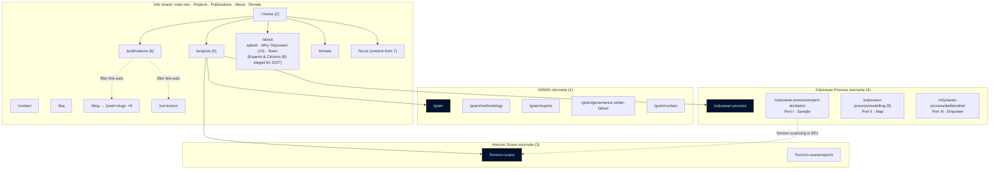
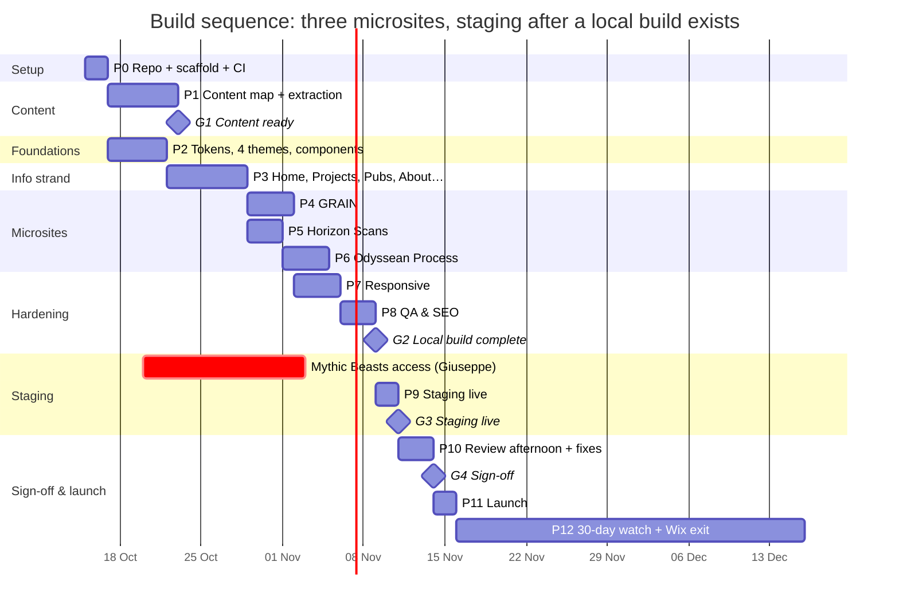

# Odyssean Institute website: build plan

> **Status:** v2.0 · 2026-10-14 · **The single planning document.** It replaces `task-plan.md` (deprecated) and absorbs everything from it that still applies.
> **Background (not planning):** [scoping.md](scoping.md) (findings, risks, inventory) · [existing-snapshot.md](existing-snapshot.md)
> **Design inputs:** [new-design/extracted/](new-design/extracted/README.md) (ground truth) · [new-design/open-questions.md](new-design/open-questions.md) (live)
> **Purpose:** give Devin enough structure, decisions and rules to build the site **more or less on its own**, with Will steering.

---

## Contents

- [Part A: Summary](#part-a-summary)
- [Part B: Information architecture](#part-b-information-architecture)
- [Part C: Architecture & style system](#part-c-architecture--style-system)
- [Part D: Work plan](#part-d-work-plan)
- [Part E: Operating rules](#part-e-operating-rules)
- [Part F: Gates, review, launch & handover](#part-f-gates-review-launch--handover)
- [Part G: Dependencies, risks & backlog](#part-g-dependencies-risks--backlog)

---

## Part A: Summary

| | |
|---|---|
| **What** | A static rebuild of odysseaninstitute.org to Hunter's concept. The site is restructured into one **info strand** (shared main nav) and **three programme microsites**, each with its own sub-nav and its own look: **GRAIN**, **Horizon Scans** and the **Odyssean Process** |
| **Stack** | **Astro** (static output) · plain CSS with design tokens and per-microsite themes · small vanilla-TypeScript enhancements · content in typed Markdown/YAML collections · GitHub Actions → `rsync` to **Mythic Beasts** |
| **Content rule** | Concept text is approved and used word for word. Gaps are filled from the live site (including its PDFs). Anything else becomes a content request. **We never write copy** |
| **Missing design** | Graphics the concept doesn't cover get **representative placeholders**, each swappable by changing one folder. All layouts are responsive and follow each microsite's style; responsive *art* (phone-specific graphics) comes later |
| **Design authority** | **The slides are ground truth.** Where they're silent, Devin extends their components and decides when one option clearly fits. Conflicts go to Will |
| **Escalation** | Devin decides → Will advises → Hunter/Giuseppe only for real blockers |
| **Estimates** | Not tracked in this version. The focus is delivery. The gantt in D.3 shows sequence, not effort |

---

## Part B: Information architecture

### B.1 Site map



### B.2 Page register

**Families** set the visual language for pages the concept doesn't design (C.3).

#### Info strand

| Route | Concept | Family | Content (approved concept first, then live site) | Notes |
|-------|:-------:|--------|---------------------------------------------------|-------|
| `/` | 2 | Info landing | Concept (2); gaps from live `/` | Hero carousel ×3: **horizon (final art) / mountains / sea (placeholders)**. Default: **the same hero text in all three states**. Focus cards (2) → `/focus` |
| `/projects` | 5 | Info landing | Concept (5) | Panels → `/grain` · `/horizon-scans` · `/odyssean-process`. "Room 1 · 3 panels · Archive" are design notes, **not built** |
| `/publications` | 6 | Reading (register) | **Every entry on live `/publications`**, each verified against its PDF (D.2 task 1.5) | Filters: Policy briefs · White papers · Research reports · **Blog** · Curriculum. Blog and Curriculum are **link-outs**. "Blog & commentary" is renamed **"Blog"** |
| `/about` | 10 (+ 8 staged) | Institutional | Splash: **content request (OQ C5)** · Why we are Odyssean: concept (10) · Team: live `/team` | Order: splash → Why Odyssean → Team. **Experts & Citizens (8)** is built now as an alternative Team section, switched off; planned swap ~2027 (C.1 AD9) |
| `/focus` | 7 (content only) | Institutional | Concept (7) gives the three areas (body, quote, attribution: see `slides-text.md` appendix); live `/focus` fills gaps | **No dial.** The three areas are shown as stacked sections with pill anchors (from 7's tab buttons). The dial goes to the backlog |
| `/contact` · `/faq` · `/donate` | — | Institutional | Live pages | FAQ uses `<details>`. Donate keeps the PayPal and FreeWills links |
| `/donation-thank-you-page` | — | Institutional | Live page | **Path kept** in case PayPal's return URL points to it. `noindex` |
| `/blog` · `/post/<slug>` | — | Reading | Live blog (9 posts) | **Old `/post/` URLs kept byte for byte** (including `3-précis-…`) |
| `/curriculum` | — | Reading | Live `/curriculum`, with corrected heading structure | Its look sets the Reading family (H1 resolved: register style from 6) |

#### Microsites

| Route | Concept | Content | Notes |
|-------|:-------:|---------|-------|
| `/grain` | 1 | Concept (1); live old `/grain` fills gaps | Same path as the old page. Sub-nav from the concept |
| `/grain/methodology` · `/reports` · `/governance-under-fallout` · `/contact` | 1 (extended) | Old **`/resilient-supply-chains`** and **`/neld`** merged in, plus the GRAIN, NELD and Governance Under Fallout PDFs and Publications entries | Separate pages (D5). Gaps → content requests |
| `/horizon-scans` | 3 | Concept (3) + **top 5 issues by final rank** from the Horizon Scan paper (B.4) | Its own strand; **not** under the OP |
| `/horizon-scans/reports` | 3 (extended) | Horizon Scan PDF + related Publications entries | Default sub-page |
| `/odyssean-process` | 4 | Concept (4) | Ports I–III link to the three sub-pages |
| `/odyssean-process/expert-elicitation` | 4 (extended) | White Paper §04.2–04.3, EEJ text (pp. 16, 18) | Port I · Sample. Cross-links to Horizon Scans |
| `/odyssean-process/modelling` | **9** | Concept (9) + White Paper DMDU text (p. 19) | Port II · Map. Fan-of-futures slider |
| `/odyssean-process/deliberation` | 4 (extended) | White Paper Deliberation text (p. 17, 19) | Port III · Empower. Target of 8's "How our assemblies work" (once 8 goes live) |

#### Retired → 301

| Old | → New | Reason |
|-----|-------|--------|
| `/our-work` | `/` | Dropped (OQ C4) |
| `/outputs` | `/publications` | A hub page with nothing to merge. Its role passes to Publications *(Devin decided: clear fit)* |
| `/cause-areas` | `/focus` | Redundant |
| `/services-1` | `/about` | Old unfinished About draft |
| `/resilient-supply-chains` | `/grain/<mapped page>` | Merged into GRAIN |
| `/neld` | `/grain/<mapped page>` | Merged into GRAIN |
| `/team` | `/about#team` | Team now lives on About |
| `/_files/ugd/*.pdf` (all discovered) | `/files/<readable-name>.pdf` | Externally cited. Never break these |

### B.3 Navigation

| Context | Header | Getting around |
|---------|--------|----------------|
| Info strand | Logo · **Projects · Publications · About · Donate** (Donate in gold outline). Home uses the transparent header over the hero (2); other info pages use the navy bar (6) | Footer links to Contact, FAQ, Blog, Curriculum, Focus and **all three microsites** |
| Microsite | Logo (→ `/`) · **microsite sub-nav**, whose first item is always the microsite landing page ("About GRAIN" / "Overview") · optional CTA (GRAIN: gold "Collaborate", which opens `/grain/contact`) | Same footer as the info strand, so every strand is reachable from every page |
| Phone width | Header collapses into a single disclosure menu, styled per microsite | Sub-nav and main nav share one menu component |

**Sub-nav items** (defaults, to be refined as we build):

| Microsite | Items |
|-----------|-------|
| GRAIN | About GRAIN · Methodology · Reports · Governance Under Fallout · Contact · **Collaborate** button → Contact *(from the concept)* |
| Horizon Scans | Overview · Reports · Contact (→ `/contact`) |
| Odyssean Process | Overview · Expert Elicitation · Modelling · Deliberation |

### B.4 Horizon Scan signals (default: top 5 by final rank)

Source: *A Horizon Scan of Global Catastrophic Risks*, Table 1 (live-site PDF `cad45f_0ddb…`).

| # | Issue (verbatim) | Categories (main first) |
|---|------------------|-------------------------|
| 01 | Integration of artificial intelligence in Nuclear Weapons Systems | Nuclear Weapons, AI, War & Security |
| 02 | State Capacity Deficits | Government & Politics |
| 03 | Cascading failures of global food systems leading to famines | Food Security, Climate Environment & Ecology, Systemic Risks |
| 04 | Climate change-induced displacement in the context of escalating polycrisis | Society, Climate Environment & Ecology |
| 05 | Unclear future of the ocean carbon sink | Climate Environment & Ecology |

Each signal's "two-sentence summary" is the **first two sentences of that issue's section in the paper**. The "time horizon" is taken from the paper if it states one; otherwise the field is left empty and becomes a content request.

---

## Part C: Architecture & style system

### C.1 Architecture decisions (agreed)

| # | Decision | Choice | Rationale |
|---|----------|--------|-----------|
| AD1 | Generator | **Astro 7.3.x**, `output: 'static'`. Pin a release ≥7 days old at scaffold time (currently 7.3.6) | Components map 1:1 to the slide HTML. No JS by default. Content schemas |
| AD2 | Styling | **Plain CSS**: core tokens + **theme layers** (C.3) as custom properties; scoped component CSS; `clamp()` for fluid sizing | The slides use inline styles, so lifting them into scoped CSS is mechanical |
| AD3 | Interactivity | **Vanilla TS**, progressive enhancement: hero carousel (2), signal selector (3), horizon slider (9), publications filter (6), menu. **All content renders without JS** | The slides' own logic is 1–2 KB; no React runtime |
| AD4 | Hosting & deploy | GitHub Actions builds → `rsync` over SSH → **Mythic Beasts**. Apache `.htaccess` handles redirects, headers and caching | The host only serves files |
| AD5 | Content model | **All copy in `src/content/`**, validated by Zod schemas. **No copy in components.** Shared lists (team, publications, signals, projects, people-quotes) are data collections | Enables the future LLM editor; bad edits fail the build |
| AD6 | Art registry | `src/art/<key>/` holds `Art.astro` (SVG, responsive via `viewBox`) + `meta.json` (`status: placeholder \| final`, `source`, `mobile`, `notes`). Optional `Art.mobile.astro` later. The build prints a **placeholder report** | Swap = replace one folder |
| AD7 | Fonts | Self-host DM Mono and Instrument Sans (OFL) and **Arrus BT (licence assumed; Will is confirming)**. All three subset to WOFF2. Accessed through `--font-display`, so they can be swapped in one place | |
| AD8 | Future LLM editor | Not built now. Prepared for by AD5, a `CONTENT.md` schema guide (doubles as LLM context), git as source of truth, and edits arriving as PRs with CI validation | Can later be a small separate service that commits to GitHub |
| AD9 | Staged variants | One content flag per variant, e.g. `about.teamSection: 'team' \| 'experts-citizens'`. The inactive variant is still built, but only at a **`noindex` preview route** (`/preview/about-experts-citizens`), excluded from the sitemap | Slide 8 goes live in ~2027 with a one-line change |
| AD10 | Contact form | **PHP mail handler on Mythic Beasts** (honeypot, rate limit), with a static fallback that shows the email address. Wired up when staging exists (P9) | No third-party data processor |
| AD11 | Analytics | **None** at launch, so no cookie banner | Default from scoping; easy to add later |
| AD12 | QA tooling | **Playwright** (pinned) for screenshots, visual diff against the concept PNGs, copy parity, link and redirect checks. **axe-core** for accessibility | Reuses the headless-render approach that worked during extraction |

### C.2 Repository layout

```text
odyssean-website/                 git root → github.com/caskilo/odyssean-website (transfer to org later)
├─ docs/                          planning & design reference
├─ existing/                      Wix snapshot (read-only)
├─ site/
│  ├─ astro.config.mjs
│  ├─ public/                     favicon set · .htaccess · robots.txt · files/*.pdf
│  ├─ src/
│  │  ├─ styles/                  tokens.css · themes/{info,grain,scans,process}.css · base.css
│  │  ├─ art/<key>/               Art.astro · meta.json
│  │  ├─ components/              core/ (Logo, Button, Eyebrow, Headline, Card, RegisterRow, Footer, Menu…)
│  │  │                           grain/ · scans/ · process/ (microsite-specific components)
│  │  ├─ layouts/                 InfoLanding · Institutional · Reading · Grain · Scans · Process
│  │  ├─ content/                 pages/ posts/ publications/ team/ signals/ projects/ faq/ focus/ quotes/
│  │  ├─ content.config.ts        Zod schemas
│  │  └─ pages/                   thin routes
│  ├─ tools/                      extract/ · verify/ (visual, copy, links, redirects) · report/ (placeholders)
│  └─ CONTENT.md
└─ .github/workflows/             ci.yml · deploy.yml (enabled in P9)
```

### C.3 Style system

**Core** (shared by every strand; values taken from the slides):

| Token | Value | | Token | Value |
|-------|-------|---|-------|-------|
| `--navy` | `#011130` | | `--font-display` | Arrus BT (serif headlines, *italic accent phrase*) |
| `--blue` | `#1D4387` | | `--font-body` | Instrument Sans |
| `--gold` | `#E2B540` | | `--font-mono` | DM Mono (eyebrows, labels, captions: uppercase, tracked) |
| `--sand` | `#EBD3A2` | | `--radius` | `2px` (pills: `999px`) |
| `--paper` | `#EBE5D9` | | Headline pattern | Roman + *italic accent phrase* in the theme's accent colour |
| `--paper-light` | `#F4EFE6` | | Logo | Ring mark + wordmark in **blue** on light grounds, **gold** or **paper** on navy |

**Themes:** each strand sets the semantic tokens (`--bg`, `--fg`, `--accent`, `--eyebrow`, `--surface`, `--btn-*`, `--rule`) through `data-theme` on `<body>`.

| | **Info** | **GRAIN** | **Horizon Scans** | **Odyssean Process** |
|---|---|---|---|---|
| Source slides | 2, 5, 6, 7, 10 (+ 8) | 1 | 3 | 4 (+ 9 for Modelling) |
| Character | Institutional, welcoming | Technical report: policy and trade practitioners | Scientific instrument: researchers and foresight | Cartographic voyage: policymakers and the public |
| Ground / text | Paper / navy · home hero on navy | Paper with fine texture / navy | **Navy / paper (dark)** | Paper / navy · **Modelling page dark (9)** |
| Italic accent | Blue (light) · sand (on navy) | Blue | Sand | Blue (light) · sand (9) |
| Eyebrow | Mono, blue | Mono, navy: "GRAIN · …" | Mono, gold | Mono, navy: "Our method · …" |
| Surfaces | Paper-light cards with a 3 px coloured top rule (2) | Navy figure panels with mono "Fig. N —" captions | Paper detail card on navy | Paper-light chart panel, double-rule frame, grid |
| Buttons | Navy solid · Donate gold outline | Navy solid · blue outline · **gold "Collaborate"** | Blue-outline selectors; selected = blue fill + gold border | Navy solid (gold text, as in 10) |
| Signature elements | Horizon arc; 220 px numerals (5); register rows (6); roman-numbered sections (10) | Network diagram; numbered triad "01 — Map" | Particle tracks; numbered signal list | Voyage chart (sand coast, dashed gold route, navy port markers, compass); fan chart + gold slider (9) |
| Header | Transparent over hero (home) · navy bar (inner pages, 6) | Paper, sub-nav right | Navy, sub-nav right | Paper (navy on Modelling), sub-nav right |

**Families inside the info strand:**

| Family | Pages | Built from |
|--------|-------|------------|
| Info landing | Home, Projects | Slides 2 and 5 directly |
| Institutional | About, Focus, Contact, FAQ, Donate, thank-you | **10** (roman-numbered sections, navy illustration panel, sand CTA box) + **2** (cards) + **7** (pill buttons) |
| Reading | Publications, Blog, posts, Curriculum | **6** (left filter column, mono type labels, serif titles, sand rule dividers, navy header bar) |

### C.4 Reuse of existing work

| Already done | Reused as |
|--------------|-----------|
| `extracted/slides/*.html`: plain HTML with inline styles under each React wrapper | **Starting markup** for each concept page. Inline styles → theme tokens and scoped CSS |
| Slide scripts (3, 7, 9) | Logic for the vanilla-TS enhancements |
| Embedded fonts | Font source files |
| `extracted/screenshots/*.png` | **Visual-diff baselines** |
| `extracted/slides-text.md` (including the interactive-states appendix) | **Copy-parity list** |
| `existing/` + scoping §2 and App. A | Backup text; redirect sources |

**Style queries:** treat the slides as ground truth → check how the query fits this plan → if one option clearly fits, **decide and record it in the PR** → otherwise, or where sources conflict, ask Will.

---

## Part D: Work plan

**Method:** 🤖 Devin builds, Will reviews the diff · 👤 Will · 🤝 with Giuseppe/Hunter. Every 🤖 task includes Will's review before merge.

### D.1 Phases at a glance

| Phase | Outcome | Gate |
|-------|---------|------|
| P0 Setup | Repo, scaffold, CI | — |
| P1 Content | Every element has a source or a request; content files validate | **G1** |
| P2 Foundations | Tokens, 4 themes, core components, layouts, art registry, schemas, gallery | — |
| P3 Info strand | 11 routes (+ 9 posts) | — |
| P4 GRAIN | 5 pages | — |
| P5 Horizon Scans | 2 pages | — |
| P6 Odyssean Process | 4 pages | — |
| P7 Responsive | Every page at 360 / 768 / 1024 / 1440 | — |
| P8 QA & SEO | Visual, copy, accessibility, links, redirects, metadata | **G2** |
| P9 Staging | Live on Mythic Beasts; form and redirects proven on Apache | **G3** |
| P10 Review afternoon | Sign-off | **G4** |
| P11 Launch | DNS cutover, email intact | **G5** |
| P12 Handover & Wix exit | 30-day watch, Wix downgraded, repo transferred | **G6** |

### D.2 Task breakdown

#### P0: Setup

| ID | Task | Method | Depends | Done when |
|----|------|:------:|---------|-----------|
| 0.1 | Will creates an **empty private repo `caskilo/odyssean-website`** (no README) | 👤 | — | Repo URL exists |
| 0.2 | `git init` at the project root; `.gitignore`; first commit of `docs/` + `existing/`; push using the existing Git Credential Manager login | 🤖 | 0.1 | `main` on GitHub |
| 0.3 | Scaffold Astro (pinned) in `site/`. Prettier, `astro check` (ESLint deferred: no client JS yet; add with the P3 enhancements) | 🤖 | 0.2 | Builds clean locally |
| 0.4 | CI: build + checks on every push and PR. Deploy workflow written but **disabled** until P9 | 🤖 | 0.3 | CI green |

#### P1: Content

| ID | Task | Method | Depends | Done when |
|----|------|:------:|---------|-----------|
| 1.1 | **Content map** (`docs/content-map.md`): one row per page section with its source (concept slide / live URL / PDF + page / request ID) | 🤖 | B.2 | Every row sourced or flagged |
| 1.2 | Crawl the live pages in B.2 → Markdown/YAML in `src/content/`, keeping heading structure | 🤖 | 0.3 | Files validate |
| 1.3 | Blog: 9 posts, checked side by side against the live posts | 🤖 + 👤 | 1.2 | Footnotes, tables and captions intact; slugs identical |
| 1.4 | Concept copy → content files, including the interactive-state strings | 🤖 | 1.1 | Copy-parity list = content files |
| 1.5 | **Publications**: every live entry; **check each title against its PDF** (the live page links some titles, thumbnails and buttons to different PDFs) | 🤖 | 1.2 | Each entry has one verified PDF; mismatches logged. *PDF identification uses a dev-only Python helper (`tools/extract/identify_pdfs.py`, PyMuPDF); not part of CI* |
| 1.6 | GRAIN merge: `/resilient-supply-chains` + `/neld` + GRAIN, NELD and GUF publications → the GRAIN sub-pages | 🤖 | 1.2, 1.5 | Mapping recorded; leftovers listed |
| 1.7 | Horizon Scans: top 5 signals + summaries from the paper (B.4) | 🤖 | — | `signals/` collection filled |
| 1.8 | Odyssean Process: EEJ, DMDU and Deliberation text lifted verbatim from the White Paper (§04.2–04.3) | 🤖 | — | Sources cited per section |
| 1.9 | Assets: every discovered PDF with a readable name, images normalised, alt text | 🤖 | 1.2, 1.5 | Asset manifest; redirect source list |
| 1.10 | Batch the remaining gaps into **content requests** in open-questions.md | 🤖 | 1.1–1.8 | One request per gap |

#### P2: Foundations

| ID | Task | Method | Depends | Done when |
|----|------|:------:|---------|-----------|
| 2.1 | `tokens.css` (core) + `themes/*.css` (4 themes, C.3) + fonts + base type scale | 🤖 | 0.3 | Token and theme preview page |
| 2.2 | Core components from the slides: Logo (3 colourways), Header (transparent / bar / microsite), Menu, Eyebrow, Headline (with accent), Button set, Card, RegisterRow, PageTitle, RomanSection (10), Pill, Footer (with footer logo, 7), Mark uses (favicon, loader, section marker) | 🤖 | 2.1 | **Component gallery** at `/preview/components` (noindex) |
| 2.3 | Layouts: InfoLanding, Institutional, Reading, Grain, Scans, Process | 🤖 | 2.2 | Each renders sample content |
| 2.4 | Art registry + placeholder report (AD6) | 🤖 | 2.1 | `npm run report:placeholders` |
| 2.5 | Content schemas + `CONTENT.md` (AD5/AD8) + variant flags (AD9) | 🤖 | 1.1 | Invalid content fails the build |

> **P2 status: done 2026-10-15.** Gallery at `/preview/components` (noindex, excluded from the sitemap). Deviations: (1) the mobile menu is a CSS-only `<details>` disclosure, so it works without JS; (2) accessibility labels and the copyright line live in `settings/site.yaml` (`ui`, `copyright`), keeping components copy-free; (3) the three hero art entries (`hero-horizon` final, `hero-mountains` and `hero-sea` placeholders) were pulled forward from 3.1 to exercise the registry; (4) logo colourways and the six fonts were extracted from the concept slides, not redrawn; (5) the loader mark is built but unused until a page needs it.

#### P3: Info strand

All P3–P6 tasks are 🤖 and follow E.3 (definition of done).

| ID | Task | Concept | Done when |
|----|------|:-------:|-----------|
| 3.1 | **Home**: hero carousel (3 art states; reduced-motion respected; dots as in the concept) + focus cards | 2 | Visual diff vs `02-home.png`; works without JS |
| 3.2 | **Projects**: 3 panels → microsites | 5 | Visual diff vs `05-projects.png` |
| 3.3 | **Publications**: register + filters (link-outs for Blog and Curriculum) | 6 | Visual diff vs `06-publications.png`; without JS the full list shows |
| 3.4 | **About**: splash (placeholder until C5) · Why we are Odyssean · Team; Experts & Citizens built behind the flag, with its preview route | 10, 8 | Visual diff vs `10-…png` for that section; preview of `08-…png` |
| 3.5 | **Focus**: three areas from 7, pill anchors | 7 | Copy parity incl. appendix |
| 3.6 | Contact (form UI, AD10) · FAQ · Donate · thank-you | — | Institutional family; built from gallery components only |
| 3.7 | Blog index · post template · Curriculum | — | Reading family; 9 posts render |

#### P4: GRAIN microsite

| ID | Task | Concept | Done when |
|----|------|:-------:|-----------|
| 4.1 | Grain theme + sub-nav; network graphic as `art/grain-network` (final art, from the concept) | 1 | — |
| 4.2 | **GRAIN landing** | 1 | Visual diff vs `01-grain.png` |
| 4.3 | 4 sub-pages (Collaborate is a button to Contact, decided 2026-10-19) from the 1.6 mapping, extended from slide 1's components | 1 ext. | Each section sourced or requested |

> **P4 status: done 2026-10-18.** The five sub-pages were already built in P3 by the `prose` template on the Grain layout (content from P1), so P4 added the landing (`views/GrainLanding.astro`), `art/grain-network` and the paper mesh texture in `themes/grain.css`. Deviations: (1) the "nodes of persisting recovery" label is right-aligned so it is no longer clipped as in the concept; (2) the landing's below-fold body is the full live GRAIN text, rendered after the three pillars; (3) the headline wraps naturally (`text-wrap: wrap`) to match the concept's line break.

#### P5: Horizon Scans microsite

| ID | Task | Concept | Done when |
|----|------|:-------:|-----------|
| 5.1 | Scans theme (dark) + sub-nav; particle-track graphic as `art/signal-tracks`, generated from the `signals` collection | 3 | — |
| 5.2 | **Horizon Scans landing**: selector (keyboard, ARIA `aria-pressed`, works without JS as a list) | 3 | Visual diff vs `03-horizon-scan.png` (placeholder text excepted) |
| 5.3 | Reports page | 3 ext. | Lists Horizon Scan outputs from `publications` |

> **P5 status: done 2026-10-18.** Landing is `views/ScansLanding.astro` with `art/signal-tracks`. Without JS every signal card is listed and the selector is hidden; JS shows the selector (`aria-pressed` buttons) and one card at a time. Signal titles and summaries come from the `signals` collection (so the concept's placeholder text is replaced); time horizons remain content request CR-006. Reports page was already built in P3 (`publicationsFor: scans`).

#### P6: Odyssean Process microsite

| ID | Task | Concept | Done when |
|----|------|:-------:|-----------|
| 6.1 | Process theme (light + dark variant) + sub-nav; voyage chart as `art/voyage-chart` | 4 | — |
| 6.2 | **OP landing**: chart + ports I–III linking to the sub-pages | 4 | Visual diff vs `04-odyssean-process.png` |
| 6.3 | **Modelling**: fan of futures + slider (range input, live reading, works without JS showing the default state) + White Paper DMDU text | 9 | Visual diff vs `09-fan-of-futures.png`; all 3 readings |
| 6.4 | **Expert Elicitation** + **Deliberation**, extended from slide 4's components | 4 ext. | Sourced from the White Paper |

> **P6 status: done 2026-10-18.** `views/ProcessLanding.astro` + `art/voyage-chart`; `views/Modelling.astro` + `components/process/FanChart.astro`, with the fan geometry in `lib/fan.ts` shared by the server render and `scripts/fan.ts` so the no-JS state is the default slider position. Expert Elicitation and Deliberation were already built in P3 as `prose` pages. Also fixed: microsite sub-nav no longer marks "Overview" current on sub-pages (`currentHref` picks the longest matching link).

#### P7: Responsive

| ID | Task | Done when |
|----|------|-----------|
| 7.1 | Responsive pass on every layout and component at 360 / 768 / 1024 / 1440 px, following each theme. Graphics scale via `viewBox`; where an SVG becomes unreadable at phone width, simplify it (e.g. hide minor labels) and log it in the placeholder report as `mobile: interim` | No horizontal scroll; tap targets ≥44 px; type ≥16 px body |
| 7.2 | Layout questions that need judgement → Will, batched | Resolved or escalated |

> **P7 status: done 2026-10-18** (7.2 open: see the questions in [code-review-guide.md](code-review-guide.md) §6). `npm run verify:responsive` audits every built route at 360/768/1024/1440 and passes: no horizontal scroll; at ≤768px stand-alone tap targets ≥44px and non-mono body text ≥16px (inline links and mono labels exempt). Changes: `--step-small` is 1rem at ≤768px; `.tap` utility, 44px minimum on buttons, logos, filter links and hero dots; long URLs wrap in prose; GRAIN pillars, Process ports and team rows stack on narrow screens; microsite charts enlarge or drop labels on phones and are logged `mobile: interim` (`signal-tracks`, `voyage-chart`; the fan chart is a component, not registry art).

#### P8: QA & SEO → Gate G2

| ID | Task | Done when |
|----|------|-----------|
| 8.1 | **Visual diff** of the concept pages at 1440 vs baseline PNGs | Each diff explained or fixed |
| 8.2 | **Copy parity**: every approved string present; **no design notes** present (blocklist: slide titles, "Room 1", "same format", "Homepage · Focus areas", …) | Script passes |
| 8.3 | axe + keyboard + contrast; Lighthouse | No serious issues; ≥90 across the board |
| 8.4 | SEO: per-page meta/OG, `sitemap.xml`, RSS at **`/blog-feed.xml`**, canonicals, `robots.txt`, preview routes `noindex` | Validated |
| 8.5 | **Redirects**: `.htaccess` generated from the B.2 retired list + the asset manifest; tested against a local Apache-compatible check | Every old URL → 200 |
| 8.6 | Link check (internal + external); dead external links **reported, not fixed** | Report filed |

> **P8 status: done 2026-10-19** (G2 still needs Will to review the placeholder report). Results, fixes and the explained visual differences are in [qa-report.md](qa-report.md). New checks: `verify:built`, `verify:redirects`, `verify:links`, `verify:a11y`, `verify:lighthouse`. `dist/.htaccess` is generated at build from `tools/redirects/legacy.json`; the real-server test is 9.4. External link report: [link-report.md](link-report.md).

#### P9: Staging on Mythic Beasts → Gate G3

| ID | Task | Method | Depends | Done when |
|----|------|:------:|---------|-----------|
| 9.1 | Access from Giuseppe: hosting account, SSH key | 👤 🤝 | — | SSH works |
| 9.2 | Enable the deploy workflow → staging (subdomain or path), password-protected via `.htaccess` | 🤖 | 9.1, G2 | Staging URL live |
| 9.3 | PHP form handler (AD10); delivery test to Google Workspace | 🤖 | 9.2 | Test message received |
| 9.4 | Re-run redirect and link checks **on Apache** | 🤖 | 9.2 | Pass |

#### P10–P12: see Part F.

### D.3 Sequence

> Shows sequence and overlap only. Bar lengths are illustrative, **not estimates**.



---

## Part E: Operating rules

### E.1 Decision rights

| Devin decides (and records it in the PR) | Goes to Will | Goes to Hunter / Giuseppe (pause) |
|-------------------------------------------|--------------|------------------------------------|
| Code, component boundaries, CSS | Layout calls where slides conflict or are ambiguous | Anything needing **new copy** |
| Extending slide components to pages without a design, **when one option clearly fits** | Choosing between two reasonable options | IA changes beyond Part B |
| Representative placeholder art and interim mobile simplifications | Whether a placeholder is good enough to show | A design element that **contradicts** the concept |
| Accessibility and performance fixes | Anything that changes scope | Licence, legal and brand questions |

### E.2 Hard rules

1. **No copy is written.** Concept text is used verbatim. Live-site text (including its PDFs) only fills gaps. Never overwrite concept text.
2. **Design notes are never shipped** (blocklist in 8.2).
3. **Every placeholder is registered** and appears in the report.
4. **No copy in components.**
5. **Every old URL redirects.** No 404s for anything in the inventory.
6. **Pages work without JS.**
7. **Dependencies:** exact pins; only releases at least 7 days old.
8. **Small PRs**, one task ID each, so Will can review them quickly.

### E.3 Definition of done (per page)

- [ ] Content comes from `src/content/`, is schema-valid, and its source is in the content map
- [ ] Concept pages: visual diff at 1440 explained · copy parity passes
- [ ] Non-concept pages: built only from gallery components in the correct family or theme
- [ ] Renders at 360 / 768 / 1024 / 1440
- [ ] Keyboard navigable; axe clean
- [ ] Old URLs redirect; placeholders registered

---

## Part F: Gates, review, launch & handover

### F.1 Gates

| Gate | Exit criteria | Decider |
|------|---------------|---------|
| **G1** Content ready | Content map complete: every element sourced or requested · schemas valid · copy-parity list loaded | Will · ✅ **criteria met 2026-10-14** (awaiting Will's review): `npm run check` + `npm run verify:content` pass; [content-map.md](content-map.md) generated |
| **G2** Local build complete | Every route in Part B built · E.3 met on every page · P8 checks pass · placeholder report reviewed by Will | Will |
| **G3** Staging live | Deployed via CI to Mythic Beasts · redirects and form proven on Apache | Will |
| **G4** Sign-off | Review afternoon held · Giuseppe signs off · launch-blockers fixed · rest on the backlog | Giuseppe |
| **G5** Launch | DNS cut over · site, email, redirects and PDFs verified | Will |
| **G6** Wix exit & handover | 30 days post-launch · 404 log clean · Wix downgraded · repo transferred to the org · runbook delivered | Will → Giuseppe |

### F.2 Change control

> [!IMPORTANT]
> **After G1, anything not in the concept, Part B or the agreed defaults is a change request.** It goes to the backlog (G.3), and is done after launch unless Giuseppe swaps it for something already in scope. **The review afternoon is the only sanctioned place for design changes**: made live, in the room, within the time box. Feedback outside the room goes to the backlog.

### F.3 P10: Review afternoon (one sitting, ~3.5 h)

| Slot | Activity | Who |
|------|----------|-----|
| 0:00–1:00 | Walk every page on staging, by strand: info, then GRAIN, then Horizon Scans, then Odyssean Process. Log issues | Giuseppe, (Renske), Will |
| 1:00–2:30 | Fix live: Devin applies changes, Will verifies, staging redeploys | Will + Devin |
| 2:30–3:15 | Second pass. Sort what's left into launch-blocker vs backlog | All |
| 3:15–3:30 | **Sign-off** + acceptance of the **placeholder report** (placeholders are accepted for launch, not blockers) | Giuseppe |

### F.4 P11: Launch checklist

| ID | Step |
|----|------|
| 11.1 | Registrar confirmed. If the domain is registered at Wix, decide: move NS only now, transfer later |
| 11.2 | Export the full Wix DNS zone. Replicate **MX, SPF (`-all`), DKIM, DMARC** on the new DNS. Lower TTLs 48 h ahead |
| 11.3 | Delta content pull: any posts or edits made on Wix since P1 |
| 11.4 | Production deploy; TLS; smoke test on a temporary hostname |
| 11.5 | Cut over at a quiet hour. Verify the site, **email send and receive**, every redirect, every PDF. Rollback = revert NS |

### F.5 P12: Watch, Wix exit & handover

| ID | Step |
|----|------|
| 12.1 | 30-day watch: 404 log, Search Console coverage, add any missed redirects (rescues PDF citations we didn't know about) |
| 12.2 | Downgrade Wix (don't delete) after 30 days; registrar transfer if needed (may add calendar weeks) |
| 12.3 | Runbook + README + `CONTENT.md`: publish, deploy, roll back, renew, where everything lives |
| 12.4 | Transfer the repo `caskilo/odyssean-website` → charity GitHub org; move deploy secrets |
| 12.5 | Hand over the backlog (G.3); define the retainer scope |

---

## Part G: Dependencies, risks & backlog

### G.1 Dependencies

| Needed | From | Blocks | Status |
|--------|------|--------|--------|
| Empty repo `caskilo/odyssean-website` | Will | 0.2 (work can begin locally meanwhile) | ⏳ |
| Mythic Beasts access + SSH | Giuseppe (via Will) | P9 only | ⏳ requested |
| Wix owner access | Giuseppe | DNS export (11.2) and registrar check; extraction works without it | ⏳ |
| Registrar identity | Giuseppe | P11 timing | ⏳ |
| Arrus BT web licence | Will investigating | Launch only (assumed held) | ⏳ |
| About splash copy | Giuseppe (OQ C5) | 3.4 shows a placeholder until then | ⏳ |
| Content requests from 1.10 | Giuseppe / Hunter | Only the sections they name | Live |

### G.2 Risks

| Risk | Mitigation |
|------|------------|
| Review afternoon spills into async rounds | Booked in advance; agenda F.3; change control F.2 |
| Broken external PDF links | Full asset manifest; 301s; 30-day watch |
| Live-site data errors carried over (wrong PDF links) | 1.5 verification; mismatches logged for Giuseppe |
| Content-request turnaround slows G4 | Requests batched early (1.10); placeholders accepted at sign-off |
| Three themes drift into three codebases | One core component set; themes change **tokens**, not components. Microsite-only components live in `components/<microsite>/` |
| Domain registered at Wix (60-day lock) | Check early (G.1); NS-only move is acceptable for now |
| Email disruption at cutover | F.4 checklist |

### G.3 Backlog (known, deliberately out of launch scope)

| Item | Trigger |
|------|---------|
| Final art for hero states 2–3 (mountains, sea) | When design arrives → replace `art/hero-*` |
| Phone-specific art for bespoke graphics | Hunter → `Art.mobile.astro` per key |
| Focus dial (7) | If wanted after launch |
| **Experts & Citizens (8) goes live** | Assembly complete (~2027) → flip `about.teamSection` |
| LLM-assisted editing interface | After handover (AD8) |
| Blog search | If requested |
| Analytics | If requested (AD11) |

### G.4 Immediate next actions

| # | Action | Owner |
|---|--------|-------|
| 1 | Create the empty private repo `caskilo/odyssean-website` | Will |
| 2 | Ask Giuseppe for Mythic Beasts access, Wix owner access and the registrar details | Will |
| 3 | Start **P0 → P1 + P2** (work can begin locally now) | Devin |
