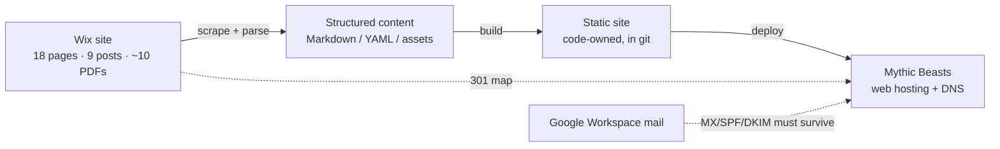
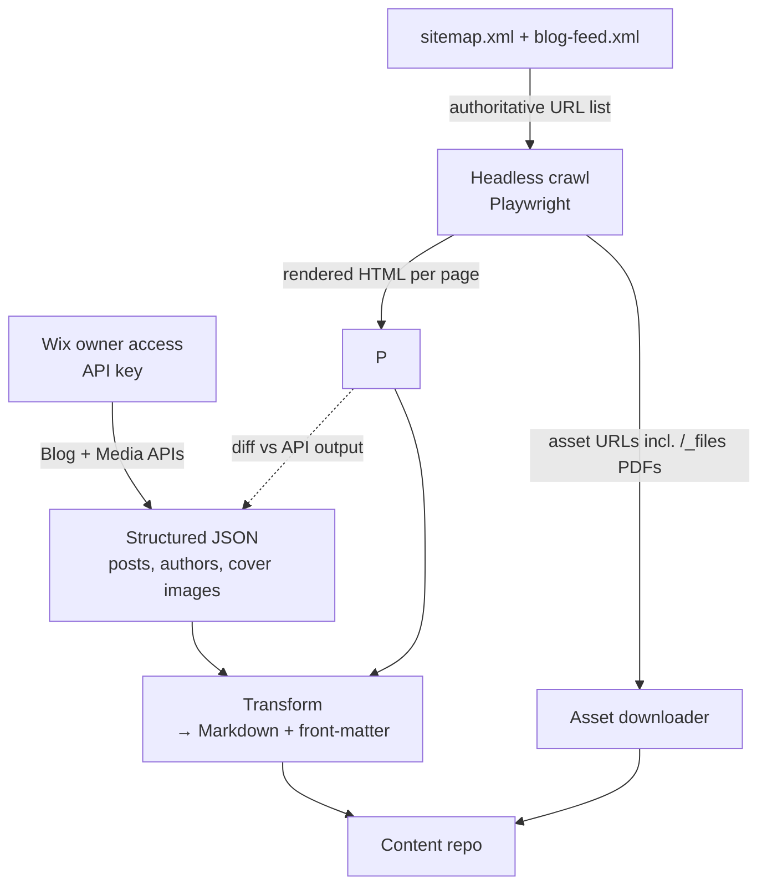

# Odyssean Institute — Website Migration Scoping

> **Status:** Draft v0.3 (lean baseline) · **Author:** Will Guest · **Date:** 2026-09-09
> **Purpose:** De-risk the move of <https://www.odysseaninstitute.org/> off Wix and onto a code-owned, redesigned static site hosted at Mythic Beasts, and state the assumptions under which a **~50 h** delivery is viable.
> **Planning:** [build-plan.md](build-plan.md) is the single planning document. This scoping doc is **background**: findings, inventory and risks. Where the two disagree, build-plan wins (e.g. site structure, which the design concept has since changed).

> [!IMPORTANT]
> This is the *why and what-could-go-wrong* document. The *who-does-what-when* lives in [build-plan.md](build-plan.md). The assumptions below still hold; the hour estimates they once supported are retired.

### Working assumptions (v0.3 — agreed baseline)

| # | Assumption | Status | If it fails |
|---|------------|:------:|-------------|
| A1 | **Retainer maintenance model** — Will maintains the repo post-launch; staff send content to Will. No CMS, no training. | ✅ Agreed | +5–10 h for CMS layer + training |
| A2 | **Complete design concept from Hunter** — tokens, all page types, responsive behaviour, graphics — delivered before build starts | ✅ Agreed | Build phase inflates; Will fills gaps at +1–2 h per missing page type |
| A3 | **Wix owner access** granted to Will → blog and media extracted via Wix API, not scraped | ✅ Agreed (pending the click) | Per-post fidelity review roughly doubles: +2–4 h |
| A4 | **Single review afternoon** — review → fix live → re-review → pass, in one sitting with Giuseppe (& Renske). No async rounds. | ✅ Agreed — **essential to viability** | Each extra async round ≈ +3–5 h and a week of calendar |
| A5 | **AI-assisted build** — extraction pipeline, templates, conversion, docs drafted by Devin with Will steering and reviewing | ✅ Working method | Human-only build ≈ 2× on Phases 1, 2 and 5 |

> [!NOTE]
> A5 is where the compression comes from. What it does **not** compress: decision meetings, the review afternoon, DNS cutover, and the 30-day post-launch redirect watch (calendar, not effort). Those are priced at human pace.

---

## Table of contents

1. [Framing](#1-framing)
2. [What exists today — site inventory](#2-what-exists-today--site-inventory)
3. [Infrastructure findings](#3-infrastructure-findings)
4. [Extraction approach](#4-extraction-approach)
5. [Target architecture (proposed)](#5-target-architecture-proposed)
6. [Pain points & risk register](#6-pain-points--risk-register)
7. [Workload drivers](#7-workload-drivers)
8. [Phase 0 — lean mobilisation](#8-phase-0--lean-mobilisation)
9. [Open questions / decisions needed](#9-open-questions--decisions-needed)
10. [Out of scope (for now)](#10-out-of-scope-for-now)
11. [Appendix A — full URL inventory](#appendix-a--full-url-inventory)

---

## 1. Framing

### 1.1 Why the original task list is wrong

The task list currently frames this as a *"Website Migration"* consisting of a **download** step (owned by Will, funding-contingent) plus structure / copy / DNS / SEO work defaulting to Giuseppe & Renske. That framing has three problems:

| # | Problem | Consequence |
|---|---------|-------------|
| 1 | "Download the old website" is treated as a discrete deliverable | A Wix "download" is a **lossy scrape**, not an export. The output still needs to be transformed into something maintainable. The value is in the transformation, not the download. |
| 2 | Structure, copy, DNS and SEO are assigned to non-technical owners | Every one of those touches code, DNS records or HTTP semantics. Leaving them with Giuseppe & Renske guarantees they come back to Will anyway — unplanned. |
| 3 | The 0.5–1 hr original guess for the download (revised to 3–6 hr) anchors everyone low | The revision fixed one line; the anchor persists across the rest of the list. |

### 1.2 What we're actually doing



> [!NOTE]
> Everything to the right of the first arrow is new build, not migration — and with a redesign in scope, the build is the bulk of the work. The word "migration" undersells it to stakeholders. Suggest renaming the workstream **"Website rebuild & Wix exit"**.

### 1.3 Success criteria (proposed — to confirm with Giuseppe & Renske)

- [ ] Every current public URL either resolves identically or 301s to its new home
- [ ] Every PDF currently linked from external sources (papers, LinkedIn, newsletters) still downloads
- [ ] Contact form works and delivers to `contact@odysseaninstitute.org`
- [ ] Email delivery unaffected throughout
- [ ] Site implements Hunter's design concept and is signed off by Giuseppe at the review afternoon
- [ ] Site is in a git repository the charity owns
- [ ] Will is confirmed as maintainer on a defined retainer (A1)
- [ ] Wix subscription can be cancelled with no loss

### 1.4 Maintenance model — decided: retainer

> [!NOTE]
> **Decision (A1):** Will maintains the repo after launch on a small retainer; staff send content changes and new posts to Will. This was the single biggest architectural fork and it is now closed.

Consequences:

| Area | Effect |
|------|--------|
| Architecture | Plain Markdown in git, deploy via CI. **No CMS, no auth layer, no editorial UI.** Simplest and most robust option. |
| Build | −4–8 h vs. self-serve |
| Handover | Runbook only; no training session |
| Ongoing | Retainer hours to be defined at handover (task 5.2). Expected volume: ~1 blog post/quarter based on current cadence, plus occasional page edits |
| Reversibility | A git-backed CMS can be added later without rework to the content model — the door stays open |

---

## 2. What exists today — site inventory

Compiled from `sitemap.xml`, `pages-sitemap.xml`, `blog-posts-sitemap.xml`, `blog-feed.xml` and manual page reads on 2026-09-09.

### 2.1 Pages (18 in sitemap)

| Route | In nav? | Content type | Notable |
|-------|:-------:|--------------|---------|
| `/` | ✅ | Marketing home | Hero, 3 focus tiles w/ quotes, 4 project tiles, **embedded contact form** |
| `/our-work` | ✅ | Section landing | |
| `/focus` | ✅ | Long copy | |
| `/team` | ✅ | ~15 bios + headshots | Team + Advisors; images in mixed formats (`.png`, `.jpg`, `.webp`) |
| `/projects` | ✅ | Project cards | |
| `/faq` | ✅ | Q&A | Likely Wix accordion widget |
| `/outputs` | ✅ | Section landing | |
| `/publications` | ✅ | ~10 publication cards | Each → PDF or external DOI. Thumbnails. |
| `/blog` | ✅ | Wix Blog app | Search, "All Posts" category filter, author, read-time |
| `/curriculum` | ✅ | **Very long** reading list | ~80 external links; heading semantics are broken (body copy is `<h2>`/`<h3>`) |
| `/contact` | ✅ | Wix Forms | |
| `/donate` | ✅ | Two external buttons | PayPal hosted button, FreeWills — trivially portable |
| `/grain` | ➖ | Project page | Linked from home |
| `/resilient-supply-chains` | ➖ | Project page | Linked from home |
| `/cause-areas` | ➖ | Long copy | Linked from home "Learn More" — **overlaps with `/focus`** |
| `/neld` | ❌ | Unknown | Orphan — in sitemap, not in nav. Draft? Dead? |
| `/services-1` | ❌ | Old "about" page | Orphan. Contains placeholder text *"Word. Definition..."* — clearly unfinished |
| `/donation-thank-you-page` | ❌ | Post-donate landing | Referenced by PayPal return URL? |

#### Editorial & design review (per page)

Every page above gets a keep/merge/kill and template decision at the **kickoff call**, using the checklist below (Will pre-fills it; Giuseppe & Renske confirm or overrule). This is where unfinished content, duplication and design decisions get resolved together, rather than being discovered mid-build.

| Check | Question | Known cases |
|-------|----------|-------------|
| **Keep / merge / kill** | Does this page survive into the new site? | `/services-1` (placeholder text), `/neld` (orphan), `/cause-areas` vs `/focus` (overlap), `/donation-thank-you-page` |
| **Copy status** | Is the copy final, or does it need an edit before port? | `/services-1` has *"Word. Definition..."* placeholder |
| **Design mapping** | Which template / component in Hunter's concept does this page map to? Any page-specific layout needs? | Home (hero + tiles), Team (bio grid), Publications (cards), Curriculum (reading list — needs a bespoke pattern) |
| **Media** | Are the images fit for the new design? Any to replace? Alt text present? | Team headshots in mixed formats |
| **Links** | Any known-dead outbound links? | Curriculum (~80 links, likely rot) |
| **URL** | Does the slug stay, or change (→ redirect)? | All |
| **Priority** | Launch-blocking, or can follow post-launch? | — |

### 2.2 Blog posts (9)

| Date | Title | Author | Length |
|------|-------|--------|--------|
| 2026-09-03 | An Odyssey Launched: Update on the First Odyssean Process | Giuseppe Dal Prá | 6 min |
| 2025-12-30 | Our 2025 in Review | Giuseppe Dal Prá | 8 min |
| 2025-09-29 | Why Most Efforts Towards "Democratic AI" Fall Short | Jacob Haimes | 8 min |
| 2025-07-14 | 3 Précis: Our Tripartite Research & Advocacy Agenda | Giuseppe Dal Prá | 13 min |
| 2025-05-06 | Which (future) is the fairest of them all? … Horizon Summits | James Balzer | — |
| 2024-12-31 | Our 2024 in Review | Giuseppe Dal Prá | — |
| 2024-05-07 | Applying a Problem-Solving Mindset to Social and Political Challenges | OI Team | — |
| 2024-05-07 | Let's Talk About Emergence | Jacob Haimes | — |
| 2024-05-07 | Pathways to Resilience: … Small Island States Resilience Initiative | OI Team | — |

Posts are **long-form with rich formatting**: numbered footnotes with anchor links, HTML tables, captioned images with attribution, bold/italic inline, nested lists. Slug `3-précis-…` contains a **non-ASCII character** (`é`) — URL-encoded as `3-pr%C3%A9cis-…`.

> [!WARNING]
> The blog is the highest-fidelity-risk content on the site. Rich text → Markdown conversion of footnoted, tabled articles is where scrapers silently drop things. Budget for a **manual side-by-side review of every post**, not a spot-check.

### 2.3 Documents (PDFs at `/_files/ugd/…`)

At least **9 distinct PDFs** identified so far, including the White Paper, Policy Brief, Horizon Scan, GRAIN report, Governance Under Fallout, NELD paper(s). These live at opaque Wix URLs like:

```
/_files/ugd/e56281_f0a77ff859354023bf743d07b9cea519.pdf
/_files/ugd/cad45f_0ddb2ff8abe74792af7dc19e63fd81d2.pdf
```

> [!CAUTION]
> These URLs are almost certainly cited in **external places the charity does not control** — academic papers, funder reports, LinkedIn posts, newsletters. Breaking them is reputationally worse than breaking a page. Every one needs a 301, and we can only redirect the ones we *discover*. There is no authoritative list.

### 2.4 Media

- Page images served from `static.wixstatic.com/media/<id>~mv2.<ext>` with Wix's on-the-fly resizing/format params
- Blog cover images and inline images likewise
- Team headshots in `.png`/`.jpg`/`.webp` — inconsistent
- Image `alt` text present on some blog covers (good, worth preserving)

### 2.5 Interactive / dynamic Wix features

| Feature | Where | Replacement difficulty |
|---------|-------|:----------------------:|
| Contact form (Wix Forms) | `/`, `/contact` | 🟡 Needs a form backend — see [§9](#9-open-questions--decisions-needed) |
| Blog search | `/blog` | 🟢 Drop, or client-side search (Pagefind etc.) |
| Blog categories | `/blog` | 🟢 Only "All Posts" is visible; likely unused |
| FAQ accordion | `/faq` | 🟢 `<details>` element |
| PayPal donate | `/donate` | 🟢 External link, copy verbatim |
| Wix analytics | site-wide | 🟡 Decide on replacement (or none) |
| Cookie banner | site-wide | 🟡 Only needed if we add tracking |
| Members / logins / e-commerce | — | ✅ None found |

---

## 3. Infrastructure findings

### 3.1 DNS & email (checked 2026-09-09)

```
odysseaninstitute.org  NS   ns12.wixdns.net, ns13.wixdns.net
odysseaninstitute.org  TXT  v=spf1 include:_spf.google.com -all
www                    CNAME→ cdn3.wixdns.net / cfd.wixdns.net
```

**Findings:**

1. **DNS is hosted at Wix.** Moving hosting means moving DNS (or at minimum changing A/CNAME records inside Wix, which keeps a Wix dependency alive).
2. **Email is Google Workspace.** SPF is `-all` (hard fail), so a missed or mistyped SPF record on the new DNS host = **outbound mail rejected**. MX, DKIM and DMARC records must be captured verbatim *before* any nameserver change.
3. **Registrar is unknown.** If the domain was *registered* through Wix (not just DNS-hosted there), a registrar transfer is subject to ICANN's 60-day lock and Wix's own unlock/auth-code process. This can add **weeks** of calendar time even though it's minutes of effort.

> [!NOTE]
> Preserving email through the cutover is routine if the zone is exported first and MX/SPF/DKIM/DMARC are replicated before the NS change. Low risk, but zero-tolerance — it goes on the launch checklist, not in the risk register's top tier. The **registrar question (point 3) is the one to clear early**, because it drives calendar time, not effort.

### 3.2 Mythic Beasts

Verified offerings (Sep 2026):

| Plan | £/mo ex VAT | Disk | Bandwidth | Fit |
|------|------------:|-----:|----------:|-----|
| Web 25 | 2.50 | 5 GB | 100 GB | Sufficient for a static site of this size |
| Web 35 | 3.50 | 10 GB | 150 GB | Comfortable headroom for PDFs |

- Free SSL, unlimited domains, DNS management in control panel, optional SSH shell access
- Domain transfer-in supported
- Static hosting is a natural fit; PHP available if a form handler needs it
- Deploy path: `rsync`/`scp` over SSH from CI, or manual

**Unknowns:** whether Mythic Beasts supports custom `.htaccess`-style redirects (needed for ~30 301s) — almost certainly yes via Apache, but must confirm. Whether they offer any form-to-email facility — assume no.

---

## 4. Extraction approach

We build our own extraction pipeline (Devin writes it; Will reviews and runs it). Wix offers no native export, but with **site owner** access (A3) the Wix REST APIs expose blog posts, media and page metadata as structured JSON. That is the primary path; a headless-browser crawl is the fallback and the cross-check. No separate spike phase — the pipeline is built directly and its first run *is* the spike.



| Content type | Primary source | Fallback | Fidelity risk |
|--------------|---------------|----------|:-------------:|
| Blog posts (9) | Wix Blog API (rich-content JSON) | Crawl + HTML→Markdown | 🟡 Footnotes, tables, captions need per-post review either way |
| Static pages (18) | Crawl + parse | — | 🟢 Copy is being re-flowed into a new design anyway; text is what matters |
| Images | Wix Media API / direct download from `static.wixstatic.com` | Crawl asset list | 🟢 |
| PDFs | Crawl for `/_files/` links | Wix Media Manager (owner UI) | 🟡 Discovery is the problem, not download |
| Metadata (titles, descriptions, OG) | Crawl `<head>` | — | 🟢 |

**Principles**

- Sitemap + RSS are the authoritative URL list. Never rely on link-following alone — orphan pages (`/neld`, `/services-1`) would be missed.
- Pin the toolchain (lockfile) on day one so extraction is repeatable — we will run it more than once (initial pull, then a final delta pull just before launch to catch any new posts).
- Preserve slugs byte-for-byte, including `3-précis-…`.

**Existing snapshot.** A crawl-based copy of the live site already exists in `existing/www.odysseaninstitute.org/` (captured 2026-09-14): ~60% of pages, 5 of 9 posts, 1 unique PDF, **no images**, plus ~26 junk files. It is catalogued in [existing-snapshot.md](existing-snapshot.md) and serves as the *diff baseline* for fidelity review of the pages it covers — it is not a golden source and does not change this pipeline.

> [!NOTE]
> **Dependency to track:** Wix owner access (A3). Agreed in principle; needs the click. If it slips, extraction still works via crawl, but per-post fidelity review roughly doubles (+2–4 h).

---

## 5. Target architecture (proposed)

**Static site generator + Markdown content + git + rsync to Mythic Beasts**, implementing Hunter's design concept.

| Concern | Proposal | Rationale |
|---------|----------|-----------|
| Generator | **Astro** (static output). Decided in [build-plan.md](build-plan.md) AD1 | Zero runtime, cheap hosting, no CMS to patch |
| Content | Markdown + YAML front-matter, one file per page/post | Diff-able, reviewable, portable if we ever leave Mythic Beasts |
| Design | Component library built from Hunter's concept: tokens (colour, type, spacing) → components → page templates | Concept-first means design decisions are made once, upstream, not per page |
| Editing (non-dev) | **None** (A1 — retainer). Staff send content to Will. | CMS can be retrofitted later without content-model rework |
| Forms | Third-party endpoint (Formspree/Web3Forms-style) **or** tiny PHP mailer on Mythic Beasts | Static hosts can't receive POSTs natively |
| Redirects | Apache `.htaccess` `Redirect 301` map | ~30 rules incl. PDFs |
| Deploy | GitHub Actions → `rsync` over SSH | Reproducible; no manual FTP |
| Analytics | None, or privacy-preserving (Plausible/GoatCounter) | Avoids cookie banner if none |
| TLS | Mythic Beasts free cert | |

### 5.1 Design & review workflow

```mermaid
sequenceDiagram
    participant H as Hunter
    participant W as Will + Devin
    participant G as Giuseppe (& Renske)
    H->>W: Complete design concept (A2)
    W->>W: Component inventory; map every page to a template
    W->>G: Questions on ambiguous mappings (async, batched)
    W->>W: Build to concept on staging
    Note over W,G: Review afternoon (A4) — one sitting, ~3–4 h
    G->>W: Review pass 1 (all pages)
    W->>W: Fix live (Devin applies; Will verifies)
    G->>W: Review pass 2
    G->>W: Sign-off
    Note over W,G: Not fixable in the room → post-launch backlog, not scope
```

**The review afternoon is the viability hinge.** It replaces what would otherwise be an async staging review plus a separate sign-off session plus the inevitable drift between them. Its shape:

| Slot | What happens | Who |
|------|--------------|-----|
| 0:00–1:00 | Walk every page on staging against Hunter's concept; log every issue | Giuseppe, Renske, Will |
| 1:00–2:30 | Fix live — Devin applies changes, Will verifies, staging redeploys continuously | Will (+ Devin); G&R available for quick calls |
| 2:30–3:15 | Second pass over the changed pages; remaining items sorted into *launch-blocking* vs *backlog* | All |
| 3:15–3:30 | Sign-off, or an explicit named list of launch-blockers with no further review round | Giuseppe |

> [!WARNING]
> **Scope creep is most likely to arrive as design tweaks** — "can we just move this", "try a different blue". The defence is procedural: (1) Hunter's concept is the spec; (2) all feedback happens in the room, not drip-fed before or after; (3) the afternoon has a fixed end and ends in sign-off; (4) everything else goes to a visible post-launch backlog with its own budget. This is the change-control rule in [build-plan.md](build-plan.md) F.2.

---

## 6. Pain points & risk register

Likelihood / Impact: 🔴 High · 🟡 Medium · 🟢 Low. Ordered by priority to address. Risks retired by the v0.3 assumptions are kept for the record, struck through.

| ID | Risk / pain point | L | I | When to resolve | Mitigation |
|----|-------------------|:-:|:-:|-----------------|------------|
| R1 | **Review loop breaks into async rounds** — the ~50 h baseline depends on A4 holding | 🟡 | 🔴 | Before build; enforced at review | Afternoon booked and confirmed at kickoff; agenda in §5.1; ends in sign-off or a named launch-blocker list; anything else → backlog |
| R2 | **Domain registered at Wix** → 60-day transfer lock; calendar not effort | 🟡 | 🟡 | **Week 1** | Establish registrar immediately. If Wix: start transfer early *or* keep registrar at Wix and move NS only (acceptable interim) |
| R3 | **Scope creep via design tweaks** | 🔴 | 🔴 | Throughout | Hunter's concept is the spec; feedback only in the room; fixed end; visible backlog with its own budget |
| R4 | **Hunter's concept incomplete or late** (A2) — build can't start, or Will fills gaps | 🟡 | 🔴 | Before build | "Concept complete" definition agreed: tokens, all 11 page types, responsive behaviour, graphics. Will reviews before Phase 2. Gaps cost +1–2 h each |
| R5 | **Breaking externally-cited PDF links** | 🔴 | 🔴 | Phase 1 (map) → Phase 4 (verify) | Crawl every page for `/_files/`; check GSC for indexed PDFs; 301 all; 30-day 404-log watch |
| R6 | **Funding gate** blocks start | 🔴 | 🔴 | Now | This doc + build plan are the funding case |
| R7 | **Access dependency** — Wix owner (A3), registrar, Google Admin, GSC, Mythic Beasts, GitHub org | 🟡 | 🟡 | Week 1 | Access checklist; Wix owner access agreed, needs the click |
| R8 | **Blog fidelity loss** (footnotes, tables, captions, `é` slug) | 🟡 | 🟡 | Phase 1 | API extraction (A3); per-post side-by-side review of all 9; preserve slugs exactly |
| R9 | **Editorial decisions surface mid-build** (unfinished/orphan/duplicate pages) | 🟡 | 🟡 | Kickoff | Per-page keep/merge/kill decided at kickoff using §2.1 checklist |
| R10 | **Contact form spam / deliverability** | 🟡 | 🟡 | Phase 2 | Honeypot + rate-limit; test delivery to Google Workspace; confirm inbox owner |
| R11 | **Wix cancelled too early / keeps serving after cancel** | 🟡 | 🟡 | Phase 4 | Keep Wix paid until 30 days post-launch; then downgrade, not delete |
| R12 | **Curriculum page** — ~80 links, broken heading hierarchy, likely link rot | 🟡 | 🟢 | Phase 1 | Restructure semantically; run link checker; report dead links to owners rather than fixing |
| R13 | **Email disruption at DNS cutover** (Google MX, SPF `-all`) | 🟢 | 🟡 | Phase 4 | Routine: export zone, replicate MX/SPF/DKIM/DMARC first, low TTLs, quiet-hour cutover. Launch checklist item |
| R14 | **AI-assisted output accepted unreviewed** (A5) — subtle content or markup errors ship | 🟡 | 🟡 | Throughout | Will reviews every generated diff; content parity script at G1; per-post review at 1.3; review afternoon is a human check |
| ~~R—~~ | ~~No maintenance owner~~ | | | | Retired — A1 retainer model agreed |

---

## 7. Workload drivers

The dimensions that move the estimate. v0.3 pins most of them; the remaining open ones are small.

| Driver | Lean end (baseline) | Costly end | Status |
|--------|--------------------|------------|--------|
| Maintenance model | Retainer, plain Markdown, no CMS | Self-serve CMS + training | ✅ **Pinned: retainer (A1)** |
| Design concept completeness | Complete before build | Partial; gaps filled during build | ✅ **Pinned: complete (A2)** — verify on receipt |
| Review discipline | One afternoon, in the room | Async rounds | ✅ **Pinned: afternoon (A4)** — the hinge |
| Extraction method | Wix API | Scrape + hand-fix | ✅ **Pinned: API (A3)** |
| Build method | AI-assisted, Will steering | Human-only | ✅ **Pinned (A5)** |
| Editorial cleanup | Decided at kickoff | Discovered during build | 🟡 Kickoff agenda item |
| Forms | External endpoint | Self-hosted PHP + spam | 🟢 Will decides; ±1 h |
| Redirect completeness | Sitemap URLs (~27) | + every PDF + GSC-indexed | 🟡 Open-ended on PDFs; bounded by the 30-day watch |
| DNS/registrar | NS change only | Full transfer | ❓ Registrar unknown — **week 1** |
| Analytics / cookies | None | Privacy-preserving + policy | 🟢 Default none unless asked |

> [!IMPORTANT]
> With A1–A5 pinned, the estimate's remaining sensitivity is mostly **R1 (review discipline)** and **R4 (concept completeness)**. Everything else moves the total by low single-digit hours.

---

## 8. Phase 0 — lean mobilisation

No separate spike phase. The extraction pipeline is built directly (its first run is the spike), and the decisions are taken in **one kickoff call**. Phase 0 is therefore access, one call, and one desk review.

| # | Item | Time-box (Will) | Resolves | Needs |
|---|------|:---------------:|----------|-------|
| K1 | Access: Wix owner, registrar, Google Admin/DNS export, GSC, Mythic Beasts, GitHub org | 0.5–1 h chasing | R7 | Giuseppe & Renske |
| K2 | Registrar identified; Wix DNS zone exported; renewal date noted | 0.5–1 h | R2, R13 | K1 |
| K3 | **Kickoff call (1 h):** confirm A1–A5; per-page keep/merge/kill; book the review afternoon; confirm inbox owner & analytics = none | 1–1.5 h incl. prep | R1, R9, open questions | G&R availability |
| K4 | Mythic Beasts: account open; `.htaccess`, SSH deploy, PHP mail confirmed | 0.5–1 h | Deploy/forms approach | Billing owner |
| K5 | Concept review: Hunter's concept vs page inventory → component/template map; gap list back to Hunter | 1–2 h | R4 | Hunter's concept |

**Phase 0 budget: ~4–7 h.** Gate G0 = access in hand, registrar known, kickoff decisions recorded, concept accepted or gaps listed.

---

## 9. Open questions / decisions

### Decided (v0.3)

- [x] Maintenance model → **retainer** (A1)
- [x] Redesign in scope, to **Hunter's complete concept** (A2)
- [x] **Wix owner access** to Will (A3) — agreed; pending the click
- [x] Review → **single afternoon**, review-fix-review-pass (A4)
- [x] CMS layer → **none**
- [x] Training session → **none**

### Still open — for the kickoff call

**Giuseppe & Renske**

- [ ] **Wix subscription: renewal date, plan, and whether the domain is registered there** (week 1, ideally before kickoff)
- [ ] Fate of `/services-1`, `/neld`, `/cause-areas` vs `/focus`, `/donation-thank-you-page`
- [ ] Who monitors the contact-form inbox? Is the current form receiving submissions?
- [ ] Analytics — default is none; say if wanted
- [ ] Any known external citations of PDF URLs to prioritise (funders, papers)
- [ ] Funding envelope: build (~50 h) + retainer scope
- [ ] Date for the review afternoon (book at kickoff, ~3.5 h, Giuseppe required, Renske recommended)

**Hunter**

- [ ] **Concept delivery date and contents** — tokens, typography, all 11 page types, responsive behaviour, graphics
- [ ] Availability for batched clarification questions during build

**Access to be granted to Will**

- [ ] **Wix site owner/admin**
- [ ] **Registrar login** *or* confirmation of where the domain lives
- [ ] Google Workspace admin (DKIM/DMARC) *or* an export of current DNS
- [ ] Google Search Console
- [ ] Mythic Beasts account — created by whom, billed to whom?
- [ ] GitHub org / repo under the charity's ownership

**Will (technical, own call)**

- [ ] Static site generator
- [ ] Form backend
- [ ] Image pipeline

---

## 10. Out of scope

Stated explicitly so they don't creep in unpriced:

- **Design work beyond Hunter's concept** — new layouts, alternative directions, "let's try" iterations after sign-off (→ post-launch backlog with its own budget)
- Producing the design concept or graphics themselves (→ Hunter)
- New content or copywriting
- Newsletter / mailing list integration
- Event pages, membership, e-commerce (none exist today)
- Migrating email away from Google Workspace
- Translation / i18n
- Accessibility remediation beyond what falls out of clean semantic markup

---

## Appendix A — full URL inventory

<details>
<summary>Pages (18) — from <code>pages-sitemap.xml</code></summary>

```
/
/our-work
/focus
/team
/projects
/faq
/outputs
/publications
/blog
/curriculum
/contact
/donate
/grain
/resilient-supply-chains
/cause-areas
/neld
/services-1
/donation-thank-you-page
```

</details>

<details>
<summary>Blog posts (9) — from <code>blog-posts-sitemap.xml</code></summary>

```
/post/an-odyssey-launched-update-on-the-first-odyssean-process
/post/our-2025-in-review
/post/why-democratic-ai-falls-short
/post/3-précis-our-tripartite-research-advocacy-agenda      ← non-ASCII slug
/post/which-future-is-the-fairest-of-them-all-crafting-deliberative-policy-futures-through-horizon-summ
/post/our-2024-in-review
/post/applying-a-problem-solving-mindset-to-social-and-political-challenges
/post/let-s-talk-about-emergence
/post/pathways-to-resilience-learning-from-the-small-island-states-resilience-initiative
```

</details>

<details>
<summary>PDFs discovered so far (9) — <strong>incomplete</strong>, full crawl needed</summary>

| Wix path | Appears to be |
|----------|---------------|
| `/_files/ugd/e56281_f0a77ff859354023bf743d07b9cea519.pdf` | The Odyssean Process (White Paper) |
| `/_files/ugd/cad45f_5876f7d7692242179673c8ea6fd6a195.pdf` | Odyssean Process Policy Brief |
| `/_files/ugd/cad45f_0ddb2ff8abe74792af7dc19e63fd81d2.pdf` | Horizon Scan of Global Catastrophic Risks |
| `/_files/ugd/e56281_eec666986781463f93290fa10c53732e.pdf` | Resilience Reconsidered (preprint?) |
| `/_files/ugd/cad45f_72bc5701e1de4685b9781276810ecb1f.pdf` | GRAIN Report |
| `/_files/ugd/e5ae06_0c45281acce84b9198497299d9319fde.pdf` | Governance Under Fallout |
| `/_files/ugd/e5ae06_1802664e01d343b982189da0012251dc.pdf` | Bridging local & technocratic epistemologies (NELD, Vanuatu) |
| `/_files/ugd/cad45f_fd6a6fe4045245db97bb5cac284a3196.pdf` | Bridging the Intangible (NELD, Samoa) |
| `/_files/ugd/e5ae06_1026479b2b3f4b55895adb8d877c0776.pdf` | Policy Robustness & Uncertainty (Burton et al.) |
| `/_files/ugd/cad45f_63b8af0cc2724fae949ed95107400b90.pdf` | Unidentified — linked from Odyssean Process card |

Note the three distinct upload prefixes (`e56281_`, `cad45f_`, `e5ae06_`) — likely three different Wix user accounts uploaded files over time. Worth knowing when requesting access.

</details>

<details>
<summary>Sitemaps & feeds</summary>

```
/sitemap.xml
/pages-sitemap.xml
/blog-posts-sitemap.xml
/blog-categories-sitemap.xml
/blog-feed.xml          ← RSS, includes Wix post IDs and authors
```

</details>
