By James Balzer

Adjunct Fellow, Macquarie University School of Natural Sciences

Foresight Advisor, Odyssean Institute

## 1\. Introduction

The Pacific Islands, including Samoa, face disproportionate and escalating risks from climate change, resulting in both economic and non-economic loss and damage (L&D) (Westoby et al., 2022; Nand & Bardsley, 2020). Loss & Damage refers to the unavoidable impacts of climate change that occur despite mitigation and adaptation efforts. While mitigation addresses the causes of climate change, and adaptation addresses minimising its impacts, L&D is concerned with the unavoidable and irreversible impacts of climate change (UNEP, 2025).

Non-Economic Loss and Damage (NELD) - covering non-economic social, cultural, and environmental climate impacts to communities - remains inadequately addressed in global mechanisms like the Warsaw International Mechanism and the Bridgetown Initiative (Chandra, 2023; Boda et al., 2021). The colonial nature of global development mechanisms undermines their ability to appreciate localisation pathways and bottom-up deliberation (Taylor & Middleby, 2023). For example, The Fund for Responding to Loss and Damage (FRLD) hosted by the World Bank, has drawn scrutiny over how a top-down institution will ensure transparent, climate justice-oriented disbursement. During negotiations, many developing countries opposed placing the fund at the World Bank due to concerns about its governance and track record, preferring an independent fund – a proposal ultimately overruled by developed countries’ push for the Bank as host (Howle et al., 2024; Taylor & Middleby, 2023).

Consequently, global institutions and mechanisms often lack evidence-based foundations for policymaking that reflect the lived realities of Pacific Island communities (McNamara et al., 2021; Handmer et al., 2024). Figure 1 provides an overview of NELD in the Pacific.

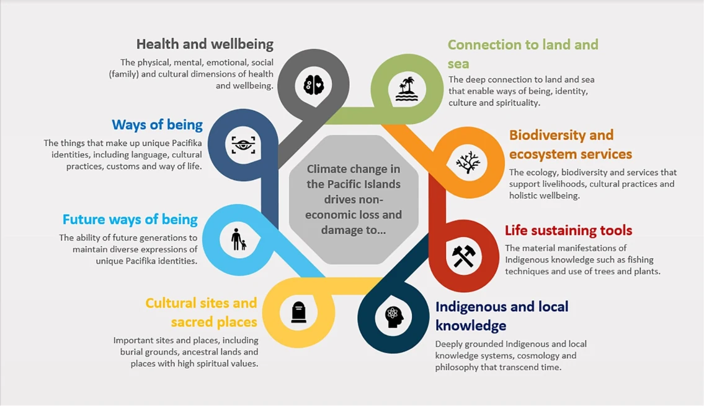

Figure 1 - An overview of NELD in the Pacific (Source: McNamara et al., 2021)

While existing scholarship has explored NELD typologies, governance, and measurement, a critical gap remains: the lack of robust tools to incorporate local epistemologies into decision-making for NELD financing delivery (Chandra, 2023; Boda et al., 2021).

This article presents a novel foresight-to-policy protocol to enable the incorporation of local epistemologies into Samoa’s NELD financing modalities. By synthesising futures methodologies - specifically the Futures Triangle and Causal Layered Analysis (CLA) (Inaytullah, 1998; 2008), with the policy taxonomy framework of Cashore & Howlett (2007) and the ‘pathways of influence framework’ (Bernstein & Cashore, 2000; Humphreys et al., 2017) - the article demonstrates a novel approach to incorporating local perspectives into NELD financing modalities in Samoa.

This article draws on insights from the 1 December 2025 workshop, "Exploring renewed evidence-based policymaking frames for the delivery of non-economic loss & damage (NELD) financing in Samoa" (‘the workshop’), held as part of the NELD Financing Policy Group. The workshop applied the novel foresight-to-policy protocol to understand NELD financing modalities for Samoa. In doing so, the workshop surfaced actionable strategies for long-term change. While regionally relevant, Samoa serves as the focal case study, offering lessons for the Pacific and beyond (also see Balzer & Margraff, 2025).

## 2\. Methodology

The methodological foundation of this article is the novel synthesis of futures methodologies - specifically the Futures Triangle and Causal Layered Analysis (CLA) - with robust policy translation frameworks. This applies the ‘deepening’ of insights through CLA, and the ‘mapping’ of futures landscapes through the Futures Triangle, as extrapolated within the ‘six pillars’ of foresight proposed by Inayatullah (2008). Resultantly, it surfaces the underlying non-economic social, environmental and cultural characteristics of Samoan communities, providing clarity for the operationalisation of NELD financing via policy translation frameworks.

### 2.1 Causal Layered Analysis

To engage in the ‘deepening’ of foresight, it is important to unpack the blended role of data, visuals and narrative in gleaning the local epistemologies of Samoan communities, as per Dykes (2019) (see Figure 2).

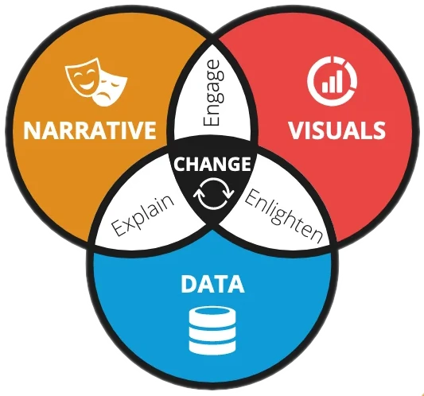

Figure 2 - Blending data, visuals and narrative for change (Source: Dykes, 2019)

In the Pacific, where oral histories and lived experience are central, this data storytelling helps translate local epistemologies into accessible formats for Loss & Damage financing (Howle et al., 2024; Bertana, 2020). Integrating narrative, data, and visuals preserves cultural integrity while enabling more just and effective access to NELD finance.

When mapped onto CLA, this is how data, visuals and narrative can be analysed for NELD in Samoa (Figure 3).

-   Litany = Data: Observable, quantifiable impacts (e.g., shrinking coastlines, number of displaced people)

-   Systemic and Worldview = Narrative: Story arcs revealing structural drivers and collective beliefs (e.g., how land tenure shapes adaptation, or how land is viewed as an ancestor in Samoa)

-   Metaphor = Visuals: Foundational cultural symbols and visual metaphors (e.g., Siva Afi as resilience; Vasa Loloa as both threat and teacher)

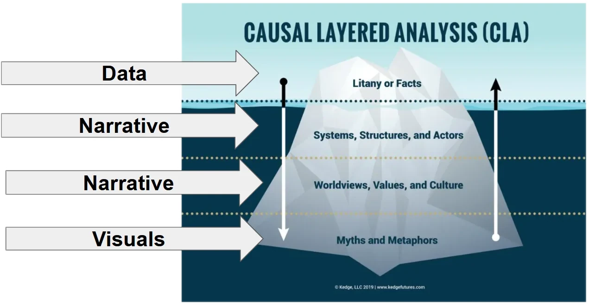

Figure 3 - Overlaying CLA with data, narrative and visuals

### 2.2 The Futures Triangle

To engage in ‘mapping’ of the futures landscape, the Futures Triangle (Inayatullah, 2008; 2023) serves as a structured way to analyse the tension between the past (hindsight), the present (insight) and the future (foresight), as per Figure 4:

-   Pushes of the Present: Immediate climate threats such as sea level rise, cyclones, and displacement, over-attachment to economic valuation that does not appreciate underlying community values

-   Weights of History: Colonial legacies, technocratic donor logic, entrenched funding practices, top-down funding practices led by international (not local) bodies

-   Pulls from the Future: Community-led visions for cultural renewal and resilience, restorative justice, “E fofo e le alamea le alamea” (what is hurt can heal itself).

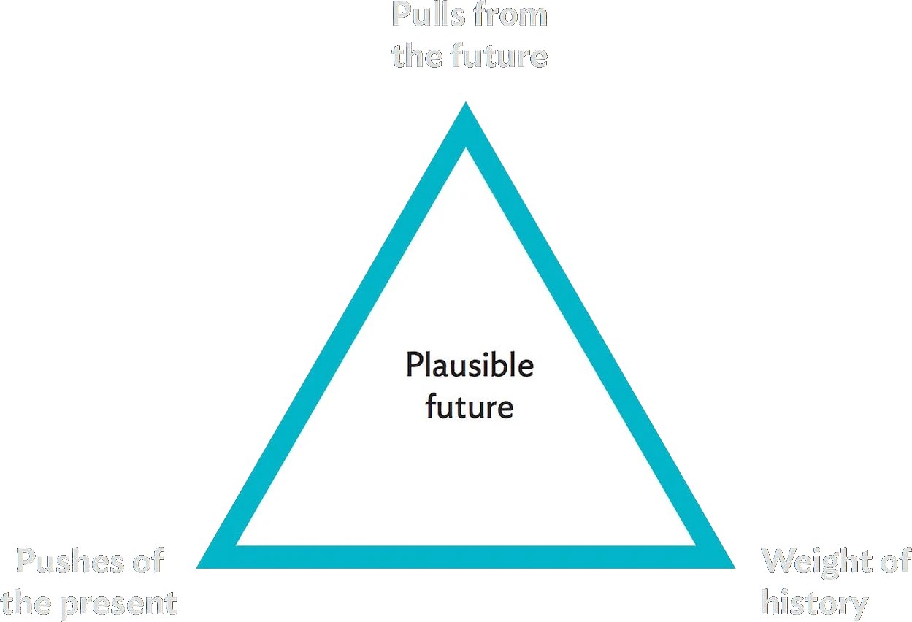

Figure 4 - The Futures Triangle

In the workshop, we overlaid CLA and the Futures Triangle, to simultaneously deepen analysis of NELD in Samoa (via CLA), and also map the tension between the past, present and future (via the Futures Triangle). This allowed a blend of breadth and depth of analysis (see Figure 5).

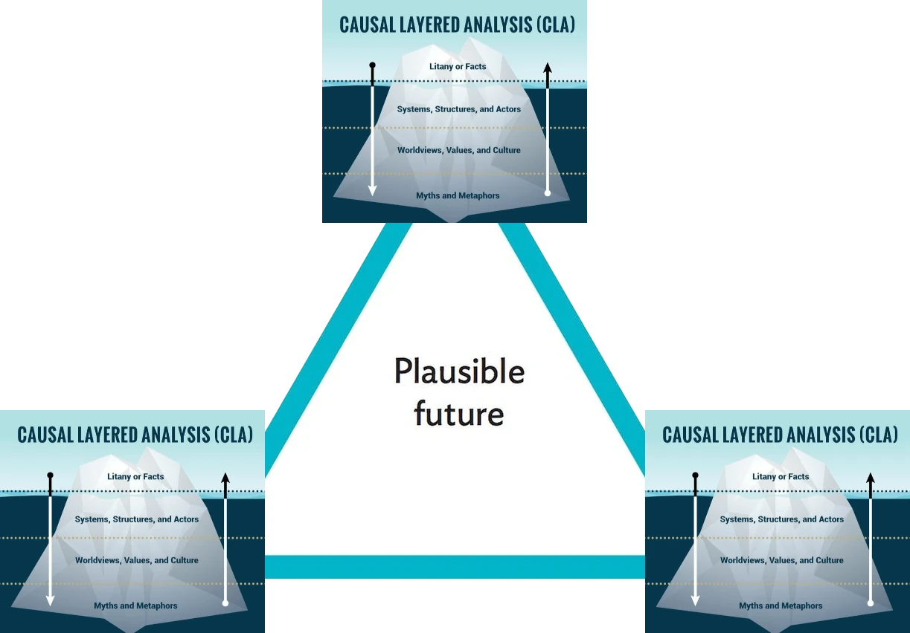

Figure 5 - Overlaying the ‘deepening’ offset CLA with the ‘mapping’ of the futures triangle

### 2.3 Linking Foresight to Policy Translation

This article blends futures methods and policy translation frameworks, providing a novel lens for understanding the layered dynamics of NELD and NELD finance modalities in Samoa. The policy taxonomy (Cashore & Howlett, 2007) breaks policy regimes into six levels: goals, objectives, and settings (policy ends) and intervention logic, tools, and calibrations (policy means) (see Figure 6).

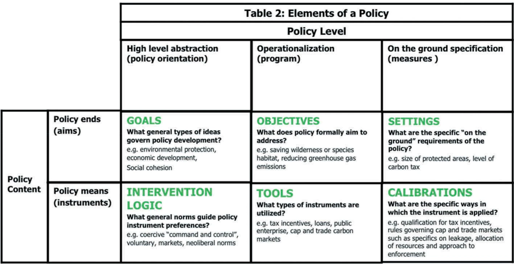

Figure 6 - Policy Taxonomy of Cashore & Howlett (2007) & Cashore et al. (2019)

This policy taxonomy can inform how Pacific policymakers, analysts and advocates to more effectively track, influence, and design context-appropriate, adaptable interventions that respond to NELD shifts in Samoa.

To complement the policy taxonomy, the ‘pathways of influence’ framework by Bernstein & Cashore (2000), and adapted by Humphreys et al. (2017) (Figure 7) provides practical avenues to apply the policy ends and means outlined in Figure 6.

These pathways of influence are:

-   Rules pathway: Influence occurs through the creation or modification of formal and informal rules, agreements, and standards that guide policy behaviour.

-   Norms pathway: Influence arises by shaping shared social values, expectations, and ideas about what is appropriate or desirable.

-   Markets pathway: Influence is exerted through economic incentives, disincentives, and the creation or shaping of markets.

-   Direct access pathway: Influence is achieved by empowering actors directly through capacity building, funding, and technology transfer.

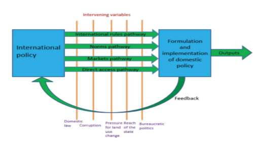

Figure 7 - ‘Pathways of Influence’ as explored by Bernstein & Cashore (2000) and Humphreys et al. (2017)

By combining the taxonomy and pathways of influence, this article equips practitioners with an integrated policy toolkit that enables the operationalisation of deep cultural knowledge and local priorities into actionable, adaptable NELD financing strategies (see Figure 8):

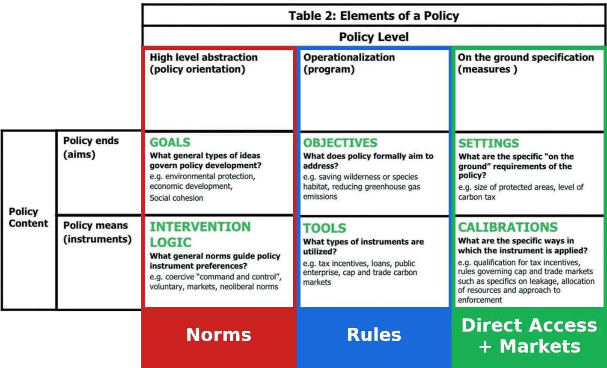

Figure 8 - Blending the policy taxonomy of Cashore & Howlett (2007)

with the pathways of influence explored by Bernstein & Cashore (2000) and Humphreys et al. (2017)

Specifically:

-   Goals and intervention logic align primarily with the norms pathway, shaping shared social values and expectations that underpin long-term visions and worldviews.

-   Objectives and tools intersect with the rules pathway, translating these shared values into formal and informal rules, agreements, and standards that guide policy behaviour and systemic structures.

-   Settings and calibrations map onto the direct access and market pathways, focusing on practical aspects of implementation - empowering local actors, shaping economic incentives, and tailoring interventions to context.

This approach is further operationalised by unpacking each pathway of influence for each layer of CLA - especially when envisioning the 'pulls from the future' corner of the Futures Triangle (Table 1).

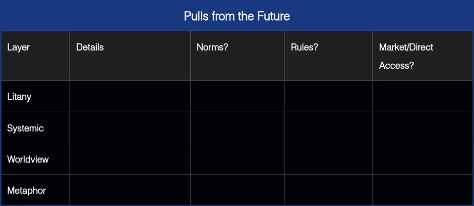

Table 1: Framework for CLA’s ‘pulls from the future’ being overlaid with the pathways of influence

This represents a novel translation of NELD financing: unpacking underlying worldviews and systems through CLA and the Futures Triangle, then proposing concrete implementation pathways via the expanded policy taxonomy and pathways of influence. This bridges the generative potential of futures methods with the practical levers of policy change, delivering a new model for NELD financing modalities.

## 3\. Results: "Exploring renewed evidence-based policymaking frames for the delivery of non-economic loss & damage (NELD) financing in Samoa"

The Pacific Community NELD Financing Community of Practice served as a testbed for the synthesis of foresight and policy translation frameworks for NELD financing in Samoa. The process unfolded in phases, moving from surfacing deep local knowledge to mapping actionable policy pathways.

### 3.1 Causal Layered Analysis and the Futures Triangle

The workshop began by using Causal Layered Analysis (CLA) to examine NELD through the lenses of data, narrative, and visuals. The workshop guided participants to use their CLA insights to map the three corners of the Futures Triangle:

Pushes of the Present:

-   Litany (Data): Attachment to a fixed future, relying on top-down data that overlooks local epistemologies.

-   Systemic (Narrative): Overreliance on economic valuation and methods, neglecting restorative justice and over-engineering management approaches.

-   Worldview (Narrative): Technocratic, neoliberal, formulaic governance; one-size-fits-all approaches that fail to capture local realities.

-   Metaphor (Visuals): The image of an engineer with a hard hat, symbolising rigid, technocratic approaches.

Weights of History:

-   Litany (Data): Lack of data and awareness; many community members are unaware of NELD.

-   Systemic (Narrative): Entrenched epistemologies and ontologies that do not accommodate local perspectives, such as Fa’a Samoa.

-   Worldview (Narrative): Intangibility of NELD clashes with cost-benefit analysis and ROI-driven policy. There is a presumption that local systems cannot effectively manage NELD finance or accountability.

-   Metaphor (Visuals): Banker with a checklist, wheel of fortune, and the proverb “E poto le tautai 'ae sese lona atu i ama” (the fisherman is skilled, but still prone to error).

Finally, and most importantly, we mapped the ‘pulls from the future’, which informed the directionality we wanted participants to focus on for the policy translation process.

Pulls from the Future:

-   Litany (Data): Recognising the future as inherently unpredictable, policy must accommodate multiple potential futures and account for unknown-unknown risks.

-   Systemic (Narrative): Building awareness and methods to define non-economic value. Qualitative data must be recognised and quantified; decisions should accommodate local perspectives and ethnographic knowledge. There was also a strong emphasis on “looking backwards” from the future, imagining that non-economic value has been built without waiting for multilateral approval.

-   Worldview (Narrative): “E fofo e le alamea le alamea” - embracing the idea that what is hurt can heal itself, and that rapid change invites a new normal rather than a return to the past.

-   Metaphor (Visuals): The Samoan idiom of “The duck may fly far, but it will always return to water” - symbolising resilience, return, and belonging.

### 3.2 Blending CLA and pathways of influence

Workshop participants then operationalised the intersection of the foresight approach and policy design by overlaying the four pathways of influence (rules, norms, markets, and direct access) with CLA layers of the ‘pulls from the future’). Table 2 outlines this integration process, noting that not every CLA layer needed a corresponding pathway of influence.

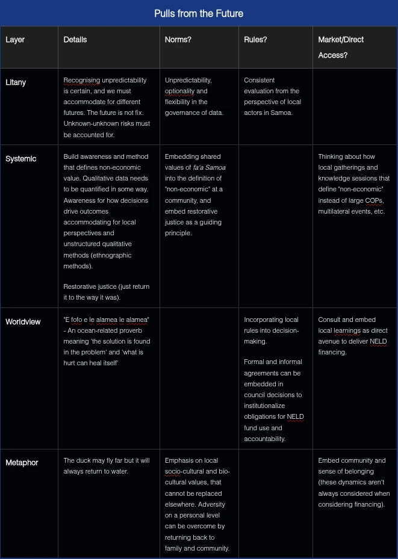

Table 2 - Integrating CLA ‘pulls from the future’ and the pathways of influence for NELD financing modalities in Samoa

Through this process, the workshop showed how deep drivers, aspirations, and cultural priorities surfaced through CLA and the Futures Triangle can be mapped directly to the practical pathways of influence. This operationalises futures literacy for NELD financing, bridging the generative potential of foresight with the practical requirements of policy delivery in the Pacific context.

### 3.3 Integrated Payoff - A Tentative Policy Taxonomy for NELD Finance in Samoa

The workshop culminated in the co-creation of a tentative policy taxonomy designed for NELD financing delivery in Samoa (Table 3). This taxonomy integrates the foresight-policy synthesis, mapping abstract goals and local epistemologies onto actionable policy ends and means as per Cashore & Howlett (2007).

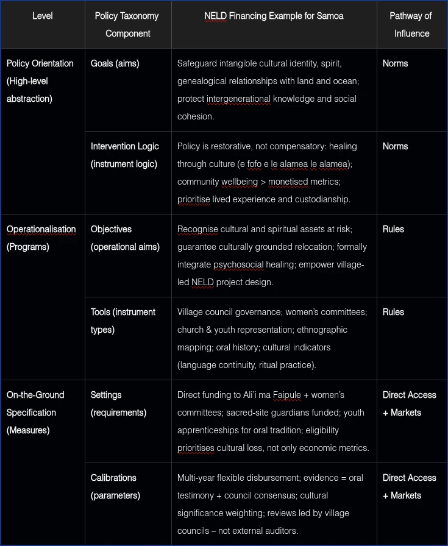

Table 3 - Tentative policy taxonomy, integrating all information gleaned in the workshop

### 3.3.1 Policy Orientation (High-level abstraction):

Goals (Aims): The overarching aim is to safeguard Samoa’s intangible cultural identity, spirit, and genealogical relationships with land and ocean, while protecting intergenerational knowledge and social cohesion. This high-level vision is rooted in local norms and aligns with the worldview and metaphor layers of the CLA—manifest in oral traditions, proverbs, and visual metaphors that prioritise belonging and custodianship.

Intervention Logic (Instrument Logic): The core logic underpinning NELD policy is restorative rather than merely compensatory. It emphasises healing through culture (e fofo e le alamea le alamea), prioritising community wellbeing and lived experience over monetised metrics. Custodianship and psychosocial healing are foregrounded, ensuring that NELD finance is attuned to the actual needs and strengths of Samoan communities.

### 3.3.2 Operationalisation (Programs):

Objectives (Operational Aims): NELD finance programs should recognise cultural and spiritual assets at risk, guarantee culturally grounded relocation if necessary, formally integrate psychosocial healing, and empower village-led, culturally embedded project design.

Tools (Instrument Types): Delivery relies on village council governance, women’s committees, and representation from churches and youth. Ethnographic mapping, oral history, and cultural indicators (such as ritual practice and language continuity) are used both for program design and measurement.

### 3.3.3 On-the-Ground Specification (Measures):

Settings (Requirements): Funding is channelled directly to Ali’i ma Faipule (chiefs and orators), women’s committees, and guardians of sacred sites. Youth apprenticeships support oral tradition, and eligibility criteria explicitly prioritise cultural loss—not merely economic impact.

Calibrations (Parameters): Flexibility is built in through multi-year, adaptive disbursement mechanisms. Evidence for project progress includes oral testimony and council consensus, with cultural significance explicitly weighted - village councils, rather than external auditors, lead reviews and adaptation.

## 4\. Conclusion: The NELD Policy Group (PG) as a Pipeline

This article has advanced a novel approach to addressing non-economic loss and damage (NELD) financing in Samoa, demonstrating how a deliberate synthesis of futures methodologies and policy translation frameworks can transform both the understanding and delivery of climate finance. By operationalising tools like Causal Layered Analysis (CLA) and the Futures Triangle, and integrating them with an expanded policy taxonomy and the pathways of influence, this work offers a new paradigm for embedding Pacific epistemologies and priorities into global financing modalities.

The workshop, convened as part of a NELD Financing Policy Group, provided a living laboratory for this approach. It showed how the integration of narrative, data, and visuals within CLA enables communities to articulate the depth and complexity of NELD in ways that are both culturally authentic and legible to external funders. Mapping these insights to the Futures Triangle ensured that local aspirations, present challenges, and historical constraints were all accounted for in policy design.

Most importantly, the process of overlaying the pathways of influence with the expanded policy taxonomy revealed actionable, context-appropriate levers for systemic change - moving from abstract goals and worldviews to operational objectives, tools, settings, and calibrations. This resulted in a tentative, but powerful, taxonomy for NELD finance delivery: one that prioritises restorative justice, cultural safeguarding, community-led governance, and the flexibility needed to accommodate uncertainty and local diversity.

## Reference List

Balzer, J., & Margraff, V. (2025, October 27). What Samoa can teach the world about non-economic loss and damage. Illuminem. [https://illuminem.com/illuminemvoices/what-samoa-can-teach-the-world-about-noneconomic-loss-and-damage](https://illuminem.com/illuminemvoices/what-samoa-can-teach-the-world-about-noneconomic-loss-and-damage)

Bernstein, S., & Cashore, B. (2000). Globalization, four paths of internationalization and domestic policy change: The case of EcoForestry in British Columbia, Canada. Canadian Journal of Political Science, 33(1), 67–99. \[suspicious link removed\]

Bertana, A. (2020). The role of power in community participation: Relocation as climate change adaptation in Fiji. Environment and Planning C: Politics and Space, 38(5), 902–919. [https://doi.org/10.1177/2399654420909384](https://doi.org/10.1177/2399654420909384)

Boda, C. S., Faran, T., Scown, M., Dorkenoo, K., Chaffin, B. C., Nastar, M., & Boyd, E. (2021). Loss and damage from climate change and implicit assumptions of sustainable development. Climatic Change, 164(13). [https://doi.org/10.1007/s10584-021-02970-z](https://doi.org/10.1007/s10584-021-02970-z)

Cashore, B., & Howlett, M. (2007). Punctuating which equilibrium? Understanding thermostatic policy dynamics in Pacific Northwest forestry. American Journal of Political Science, 51(3), 532–551. [https://doi.org/10.1111/j.1540-5907.2007.00266.x](https://doi.org/10.1111/j.1540-5907.2007.00266.x)

Chandra, A. (2023). Climate-induced non-economic loss and damage: Understanding policy responses, challenges, and future directions in Pacific Small Island Developing States. Climate, 11(3), Article 74. [https://doi.org/10.3390/cli11030074](https://doi.org/10.3390/cli11030074)

Dykes, B. (2019). Effective data storytelling: How to drive change with data, narrative and visuals (1st ed.). Wiley.

Handmer, J., Monson, R., & Schinko, T. (2024). Addressing the diversity of loss and damage in Pacific Island countries to foster a just transition towards a climate-resilient future. Climate and Development. Advance online publication. [https://doi.org/10.1080/17565529.2024.2437133](https://doi.org/10.1080/17565529.2024.2437133)

Howle, M., Burt, L., Nelson, F., Maguire, A., & Fuller, S. (2024). Non-economic loss and damage in Pacific Small Island Developing States: Ensuring climate justice through the loss and damage fund. University of Newcastle Centre for Law and Social Justice. [https://library.sprep.org/sites/default/files/2024-11/Non-economic-loss-and-damage.pdf](https://library.sprep.org/sites/default/files/2024-11/Non-economic-loss-and-damage.pdf)

Humphreys, D., Cashore, B., Visseren-Hamakers, I. J., De Jong, W., McGinley, K., Denvir, A., Caro Torres, P., & Lupberger, S. (2017). Towards durable multi-stakeholder-generated solutions: The pilot application of a problem-oriented policy learning protocol to legality certification and community rights in Peru. International Forestry Review, 19(3), 278–293. [https://doi.org/10.1505/146554817821865059](https://doi.org/10.1505/146554817821865059)

Inayatullah, S. (1998). Causal layered analysis: Poststructuralism as method. Futures, 30(8), 815–829. 00086-X)[https://doi.org/10.1016/S0016-3287(98)00086-X](https://doi.org/10.1016/S0016-3287\(98\)00086-X)

Inayatullah, S. (2008). Six pillars: Futures thinking for transforming. Foresight, 10(1), 4–21. [https://doi.org/10.1108/14636680810855991](https://doi.org/10.1108/14636680810855991)

Inayatullah, S. (2023). The futures triangle: Origins and iterations. World Futures Review, 15(1), 1–10. [https://doi.org/10.1177/19467567231154561](https://doi.org/10.1177/19467567231154561)

McNamara, K. E., Westoby, R., Clissold, R., & Chandra, A. (2021). Understanding and responding to climate-driven non-economic loss and damage in the Pacific Islands. Climate Risk Management, 33, Article 100336. [https://doi.org/10.1016/j.crm.2021.100336](https://doi.org/10.1016/j.crm.2021.100336)

Nand, M. M., & Bardsley, D. K. (2020). Climate change loss and damage: Policy implications for Pacific Island countries. Local Environment, 25(9), 725–740. [https://doi.org/10.1080/13549839.2020.1825357](https://doi.org/10.1080/13549839.2020.1825357)

Taylor, M., & Middleby, C. (2023). Aid is not development: The true character of Pacific aid. Development Policy Review, 41(Suppl. 2), Article e12745. [https://doi.org/10.1111/dpr.12745](https://doi.org/10.1111/dpr.12745)

United Nations Environment Programme. (2025). Loss and damage: Addressing the unavoidable impacts of climate change. [https://www.unep.org/topics/climate-action/loss-and-damage](https://www.unep.org/topics/climate-action/loss-and-damage)

Westoby, R., Clissold, R., McNamara, K. E., Latai-Niusulu, A., & Chandra, A. (2022). Cascading loss and loss risk multipliers amid a changing climate in the Pacific Islands. Ambio, 51(5), 1239–1246. [https://doi.org/10.1007/s13280-021-01640-9](https://doi.org/10.1007/s13280-021-01640-9)
