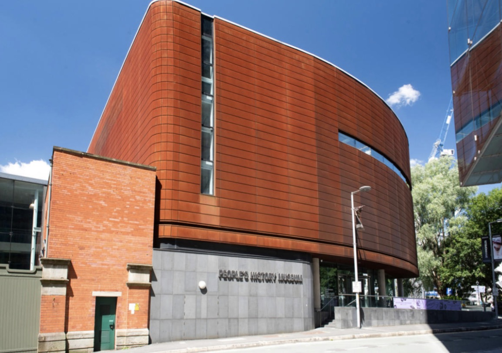
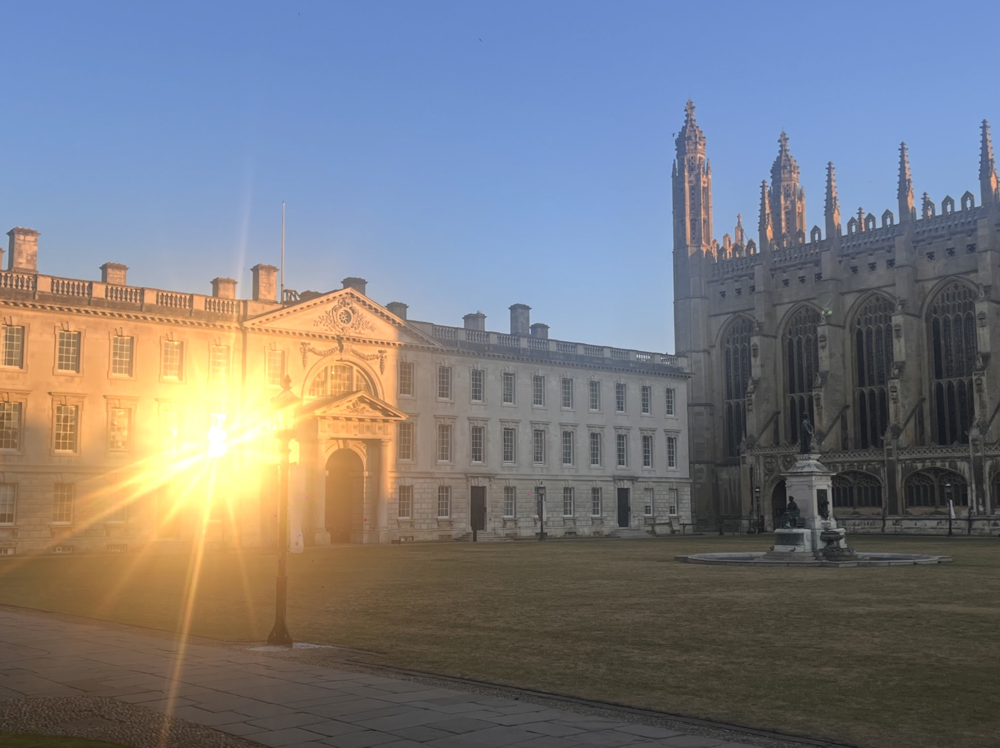
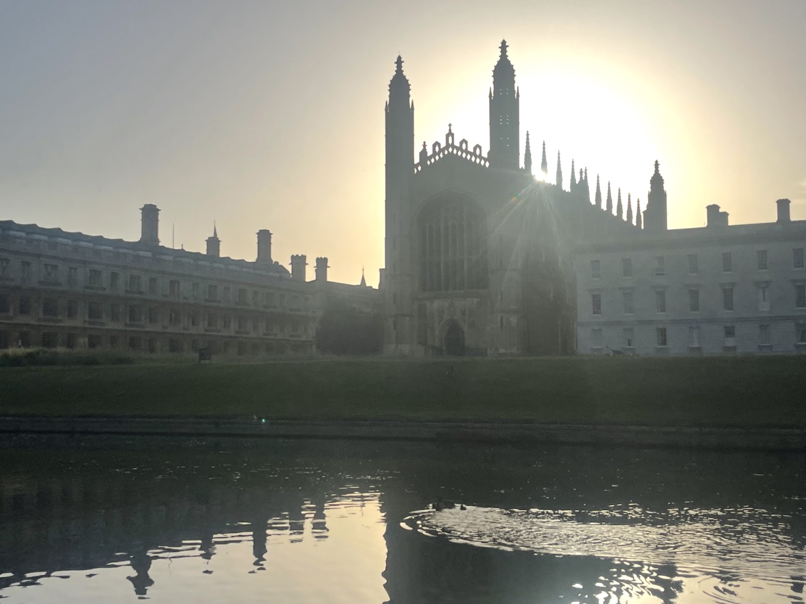

After four years of developing innovations for deliberation on existential and catastrophic risks, 2026 is proving a thrilling, if daunting, moment to deliver the inaugural [Odyssean Process](/files/odyssean-process-white-paper-2024.pdf), our flagship method for turning deliberations into robust policy signals. With developments in AI continuing to catch commentators, decision-makers, and citizens with a mixture of surprise and trepidation, time has arguably never appeared more of the essence.

It is thus a pleasure and a privilege to announce our progress with the Odyssean Process for managing catastrophic risks, as it nears its conclusion. This final operational step convenes a National Citizen's Assembly on regulating AI for civilisational resilience in the United Kingdom. Full deliberations began on the 12th July and re-commence today, continuing until the end of November. This is being conducted in partnership with the [House of the People](https://www.houseofthepeople.uk/) (the second sitting of their iterated, permanent institution for citizen deliberation in Britain) and [Involve](https://www.involve.org.uk/?gad_source=1&gad_campaignid=660719174&gbraid=0AAAAADQouTBP8kZnEuoVhECraUZGEwb7l&gclid=CjwKCAjwzNTUBhAjEiwA7zcvWvZ8rQOSsOAGQsv46n0eRdSWfyb5k_cHmy8eVwvPNw4a4aH1yuuLnxoCECEQAvD_BwE) advising.

### **Journey So Far: Delivered in 2026** **(Foresight on Risks, Solutions, & Scenarios)**

The Odyssean Process officially launched on 2nd February 2026 with invitations to 300+ experts in AI safety, ethics, and governance for an intensive Horizon and Solution Scan on AI. This first phase recruited experts by March, who then made staggered submissions thereafter of emerging, urgent AI risks and interventions to protect against them. Deploying the [IDEA Protocol](https://methodsblog.com/2018/03/27/idea-protocol-2/) as a foresight method for anticipatory analysis ensured rigorous, anonymised scoring of these submissions by May. The closing workshops distilled 18 top ranked risks from 68 initial issues, each with accompanying ranked policy interventions.

After the first Phase of the project, the Horizon and Solution Scan, concluded in May, we proceeded to Phase 2, where the [Horizon Summit methodology](https://jfsdigital.org/2026/07/23/surfacing-vulnerabilities-mapping-governance-futures-and-anticipating-policy-pathways/) developed by the OI led the expert sample to develop scenarios on risk pathways and mitigation strategies in June. This comprised mapping the top ranked risks and interventions through [Causal Layered Analysis (CLA)](https://www.shapingtomorrow.com/webtext/55), [Backcasting](https://www.betterevaluation.org/methods-approaches/methods/backcasting), [Stakeholder](https://foresight.unglobalpulse.net/blog/glossaries/stakeholder-mapping/) & [Domain](https://onlinelibrary.wiley.com/doi/full/10.1002/ffo2.70006) [Mapping](https://www.metrofutures.org/foresight-toolkit/mapping-futures-for-your-city), and risk variable, [XLRM](https://www.researchgate.net/publication/351633781_Enabling_assessment_of_distributive_justice_through_models_for_climate_change_planning_A_review_of_recent_advances_and_a_research_agenda)\-inspired workshops.

Each methodology enriches the analysis and sharpens awareness of how risks and their paired interventions interact, making implementation more tangible and practicable. Here, the objective was to excavate underlying assumptions, map the societal groups involved, and trace the pathways to preferred and harmful futures.

The Horizon Summit built from this a basis for exploratory modelling, identifying the variables that will aid citizens' and policymakers' decisions through Decision Making under Deep Uncertainty (DMDU) methods. This modelling is Phase 3, and is ongoing.

### **Landing Ashore: Ongoing 2026 Delivery** **(Causal Modelling & Citizen's Assembly)**

As part of this, [CORDA Democracy](https://cordademocracy.org/) Fellows are converting the identified variables into causal loop maps. These maps show how the risks interconnect and where interventions carry their own second-order hazards that need further analysis. They also set up mixed-methods approaches to follow through the autumn, which investigate each risk as a sociotechnical system in which technical capability, human behaviour, and institutional context combine to produce the hazard. The aim is a pipeline for AI risk management, in line with [SaferAI's argument](https://www.safer-ai.org/better-evaluations-are-not-enough-ai-governance-needs-a-better-evaluation-pipeline) that the evidence of risk matters only when it connects to timely action; reinforcing the pragmatic policy aims of the Process at large.

Conclusively, all of the qualitative and quantitative materials, as well as existing resources and literature reviews on AI safety, ethics, and governance, are being converted into educational materials for citizens alongside the House of the People, and Involve UK’s advisory support from decades of practice in citizen deliberation.

These materials enable 8 online sessions of deliberation and learning, starting on the 3rd September. These cover:

1.  The basics of how AI works,

2.  Current and emerging applications of AI

3.  The cost/benefits of AI deployment

4.  The hopes and fears of the public around AI

5.  The large scale impacts (including existential and catastrophic) of AI

6.  An interactive exploratory modelling session introducing citizens to decision aiding and how to iterate it for their deliberations

7.  Sociopolitical implications of AI development

8.  Existing or emerging regulatory/legislative frameworks for AI

All online deliberations serve to prepare the 100 demographically representative British citizens to deploy collective intelligence and their skin in the game on these enormous challenges in an in-person 3 day deliberation at the [People’s History Museum](https://phm.org.uk/) in Manchester on 27-29th November 2026.

This concludes the Odyssean Process, with the essential final deliberations developing principles and policy recommendations for strategic resilience to emerging AI risks by the public, for the public.

Findings will be published as:

1.  An accessible policy report from the public’s deliberations

2.  Open access peer reviewed papers on:

    1.  Phase 1’s Horizon and Solution Scan

    2.  Phase 2’s Horizon Summit

    3.  Phase 3’s Exploratory Modelling

    4.  Phase 4’s Citizen's Assembly

3.  A further cumulative White Paper 2.0 condensing findings and the pilots leading to this point into a practical recipe for reproducing the Odyssean Process.

### **New Horizons: 2027 & Onwards** **(Documentary & Wider Outreach)**

Last but not least, we are planning to film a documentary tracking the mounting polycrisis of first AI development and democratic backsliding, through a brief history of both and an analysis of their intersections. This will be followed by a recording of the progress of the Odyssean Process, demonstrating how its design and delivery address the multiple crises of information ecologies, declining trust in institutions, and the need for technically rigorous epistemic inputs that are robust to numerous possible futures. This media artefact will then present a reproducible recipe for movements, citizens, policymakers, and researchers to adopt.

This helps to dovetail with the necessary inspiration and mobilisation of citizens beyond technical or specialist policy audiences. This includes the House of the People’s community assemblies supporting this project, engaging the grassroots beyond the National Assembly through 10 local assemblies in areas of datacentre buildout where consultation was lacking.

A cohesive strategy to engage those most exposed and powerless at the moment, with the insights, options, and opportunities to act, can ensure that, amid rapidly emerging change and deep uncertainty, bets are spread across both insider and outsider advocacy. (Humans can play at swarming agency too, after all…)

### **Supporting this Work**

If you would like to support this work, we continue to fundraise to ensure that operational delivery reinforces extant and imminent findings and their policy advocacy.

For example, here is a [live Manifund proposal](https://manifund.org/projects/the-odyssean-process-for-ai-), open until 3 November 2026.

In Q1 & Q2 2027, we intend to finish the documentary, socialise the findings with policymakers and communities around the United Kingdom, inspiring concerted and informed action to build resilience to AI’s societal and systemic risks.

We are currently hiring Fellows to implement and refine these causal loop maps and the automated framework, helping to turn findings into practical, implementable tools for other projects in this area. If this excites you, click here to apply before 12th September!

We are actively planning and interested in further extending this model to other polities, both through the aforementioned media outputs and to ensure that decision makers have access to popular, technically sound, future-proofed policies and principles legitimately derived through this rapid operational delivery. Plans for a potential consortium delivering a 2027 Global Citizens Track Assembly on AI, another world first, are in the pipeline.

This ensures that any funding, sharing, and coalitional support lent to the OI will support ecosystem capacity building, the delivery of actionable findings, and polyvocal communication across social scales and globally, helping maintain the momentum it has been a privilege of a lifetime to help build.

Our donation page is [here](/donate), and if you would like to reach out regarding working with us on projects of this calibre and uniqueness, please reach out to [contact@odysseaninstitute.org](mailto:contact@odysseaninstitute.org)

### **Grateful Reflections**

The proof in all this pudding feels especially hard earned, with the chance to fully test the Process coming within only 3 years after publishing our White Paper. Our track record in getting here - from conducting the first [Global Catastrophic Risk Horizon Scan](https://82a3361b-35a6-46b7-bc9c-135e206d488d.filesusr.com/ugd/cad45f_0ddb2ff8abe74792af7dc19e63fd81d2.pdf) focusing on tipping points and their drivers, to the first [Horizon Summit](https://82a3361b-35a6-46b7-bc9c-135e206d488d.filesusr.com/ugd/e5ae06_0c45281acce84b9198497299d9319fde.pdf) condensing several key futures methods on resilience to nuclear risks - has been one of agile completion of ambitious aims with often lean resources.

White knuckle tail spins in public policy since 2023, ranging from failures to abate climate tipping points, institutional loss of trust, and cost of living crises seemed to only mount unanswered. With the white heat of technology now joining the roster of disruptive components of polycrisis, 2026’s in particular has felt like an urgent lesson in needing to do things very differently as a cavalcade of missteps across policy have compounded not only risks from AI, but confidence in democratic decision making generally.

In particular, the excellent fortune to be able to complete work such as this, due to preparatory lead times, nonetheless meant this project coincided with my completing a full time MPhil in Public Policy at the University of Cambridge from October 2025 to June 2026. This was an extremely rewarding course and milieu to be situated in for the awaited delivery of the Odyssean Process. The examinations, totalling 9 in 6 months in 2026, also allowed wider OI work on polycrisis, institutional reform, supply chain resilience, and participatory innovation policies to be explicated in challenging environments.

Incidentally, if the ASMR of birdsong and punting poles from King’s College Cambridge could be bottled as a soundtrack to innovative epistemic democratic work, I’d be the first to endorse it!

The simultaneity of academic and operational work, however, also made this a Herculean effort. It meant my leadership of this project had to be balanced with intense workloads. This was only possible thanks to the patience and poise of all involved, from incredible contributions by the OI’s amazing, international team spread across many continents and time zones. I give the greatest and most heartfelt thanks and appreciation to the urgent, thorough, and efficient work of our team and all of our partners in this grand undertaking.

I also wish to extend our deepest thanks to Kristian Rönn, Greg Colbourn, the Survival and Flourishing Fund, and King’s College, Cambridge for their donations making this possible.

