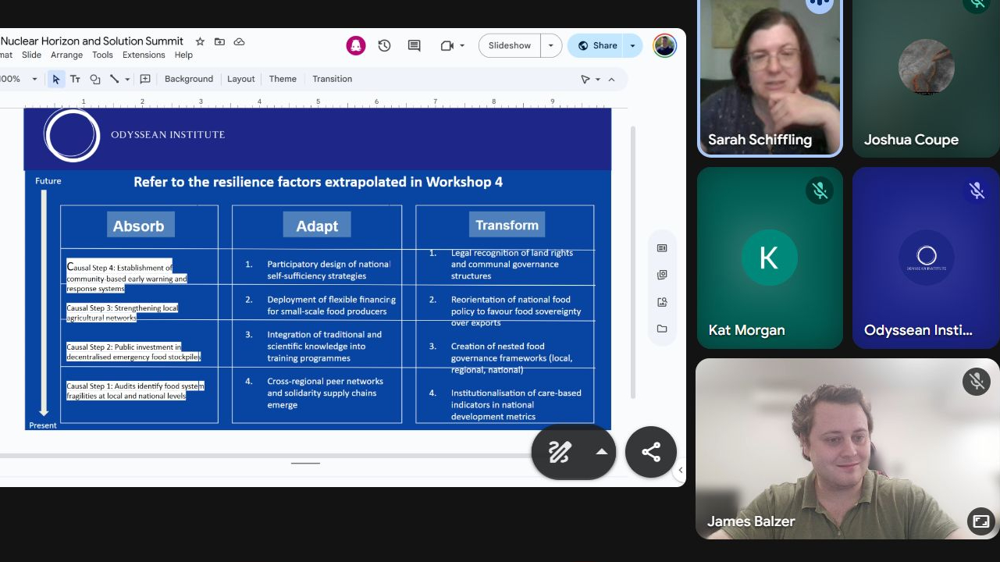

Dear Readers,

It’s been another wonderful year here at the OI, as much as it has been chaotic and worrying globally. With [some](https://www.jpl.nasa.gov/news/west-antarctic-glacier-loss-appears-unstoppable/) climate [tipping](https://www.science.org/doi/10.1126/sciadv.aba2949) points potentially already tragically [crossed](https://www.science.org/doi/10.1126/science.abn7950), and the unilateral, authoritarian [United States](https://www.carbonbrief.org/analysis-trump-election-win-could-add-4bn-tonnes-to-us-emissions-by-2030/) [shredding](https://www.presidency.ucsb.edu/documents/executive-order-14162-putting-america-first-international-environmental-agreements) any [commitments](https://www.nytimes.com/2025/12/22/climate/how-trumps-first-year-reshaped-us-energy-and-climate-policy.html) to [mitigating](https://pmc.ncbi.nlm.nih.gov/articles/PMC11925515/) these, we have also [seen](https://carnewschina.com/2025/07/21/report-china-ev-market-situation-in-first-half-of-2025/) historic Chinese buildouts of [EVs](https://www.marklines.com/en/statistics/flash_prod/automotive-production-in-china-by-month) and [renewables](https://www.pv-magazine.com/2025/08/01/chinese-pv-industry-brief-china-adds-268-gw-of-renewables-led-by-solar/) [continuing](https://www.mckinsey.com/mgi/our-research/the-hard-stuff-2025-taking-stock-of-progress-on-the-physical-challenges-of-the-energy-transition); just as we have seen the systemic (perhaps especially financial) risks of AI accumulate.

We dare say it vindicates our focus on resilience, long term wellbeing, and the criticality of continued inaction on tipping points both social and ecological. Were it possible to be wrong here, we’d wish it so. But to be aware of the growing systemic cracks becoming fissures, has enabled our urgency to reach new heights. We continue to aim for targets both hard to hit, and hard to see; because we believe with the analytical and pragmatic, as well as ambitious, aims we hold, there are leverage points that remain neglected which we can drive forward for greater impact.

Some of our highlights, in the year the OI turned 3, include:

-   Tripling our fundraising, largely to build capacity to deliver the first full iteration of the Odyssean Process, targeting the systemic and financial risks of AI

-   Executing a world-first horizon summit, combining methods such as backcasting and casual layered analysis (CLA)  to produce the report Governance Under Fallout: Anticipating and Navigating the 2nd Order Impacts of a Nuclear Strike

-   Publishing the flagship strategy for the Global Resilient Anticipatory Infrastructure Network (GRAIN), identifying ‘nodes of persisting recovery’ to strengthen global adaptive capacity

-   Advancing the AI governance prototype of the Odyssean Process, bridging expert elicitation with exploratory modelling for upcoming citizen assemblies, and a feature length documentary

-   Inaugurating the ‘Aeonic Flourishing’ research agenda, providing a multi-scalar framework for Existential Hope that transcends the limitations of current long-termist paradigms

-   Extending our transdisciplinary network through key contributions at the Global Tipping Points conference and the Festival of Commoning

In a busy year indeed, we continued our streak of world firsts in 2025. 2024 saw our delivery of the first Global Catastrophic Risk horizon scan (which is now core reading for the University of Cambridge’s MPhil in Global Risk & Resilience - appropriately enough after it covered several classes of tipping points, and the FT found 2025 to be the [year of the tipping point](https://giftarticle.ft.com/giftarticle/actions/redeem/88c519d3-ee72-4cca-a498-69f8d84c3924)) 2025 saw us deliver the first ever horizon summit. This saw the combination of causal layered analysis, stakeholder mapping, backcasting, and other stress testing futures techniques into a condensed form of foresight. We trained this on 2nd order effects of a nuclear exchange for Longview Philanthropy, culminating in the report [Governance Under Fallout: Anticipating and Navigating the 2nd Order Impacts of a Nuclear Strike](https://82a3361b-35a6-46b7-bc9c-135e206d488d.filesusr.com/ugd/e5ae06_0c45281acce84b9198497299d9319fde.pdf).

Building on this test, we also deployed a [trial Horizon Summit](https://www.linkedin.com/posts/sustainablelivinglab_aiimpactfestival-governance-ai-activity-7396860855985856512-7X5J?utm_source=share&utm_medium=member_desktop&rcm=ACoAABlWPD0BK6iYyM0GnJ6t9JW75W_RK_jnA9w) on AI governance, and subsequently conducted it again for a mixed industry group in India with [Sustainable Living Lab (SL2)](https://www.sustainablelivinglab.org/). The intention was to demonstrate the utility of condensed futures techniques for those working in the field to develop and deploy AI to think through negative and positive future scenarios, and keep concerns around equity, resilience, and subject matter areas of concern within AI ethics and safety. This served as a useful exercise to repeat the Summit format, prepare it for different sectors, and buttress our learning ready for the larger Odyssean Process in 2026.

We also published the overview report for the [Global Resilient Anticipatory Infrastructure Network (GRAIN)](https://82a3361b-35a6-46b7-bc9c-135e206d488d.filesusr.com/ugd/cad45f_72bc5701e1de4685b9781276810ecb1f.pdf). Here we outlined a bold strategy for encouraging multilateral trade and industrial policies, by combining a focus on futures and institutional efficacy, with geostrategic locations of significance to global adaptive capacity. These critical chokepoints and trade entrepôts, that we dubbed ‘nodes of persisting recovery’ are those areas where we expect trade in essential commodities, products, precursors, and techniques for adaptive capacity to pass through. This complements the existing [‘nodes of persisting complexity’](https://mdpi-res.com/d_attachment/sustainability/sustainability-13-08161/article_deploy/sustainability-13-08161.pdf?version=1626873246) literature, to build a web of nodes where possible interventions may positively cascade disproportionately globally (or conversely, where a failure to build prescience and resilience might similarly contribute harshly to collapse).

I had the pleasure of attending the University of Exeter’s [Global Tipping Points conference](https://global-tipping-points.org/conferences/conference-2025/programme/), where I saw several engaging if often sobering talks, and participated in numbers workshops. Ian Burton, who joined us not long after and who has submitted an Odyssean Institute affiliated paper [Policy Robustness & Uncertainty in Model-Based Decision Support for the Energy Transition](https://82a3361b-35a6-46b7-bc9c-135e206d488d.filesusr.com/ugd/e5ae06_1026479b2b3f4b55895adb8d877c0776.pdf) to the DMDU annual conference, was one such researcher I was especially thrilled to properly connect with, around a very helpful poster I found of his when exploring the poster session.

I had the pleasure to meet two more of our coauthors from the 2024 Horizon Scan, who were previously only met remotely - Viktoria Spaiser and Nico Wunderling, who were there also. The after party was wonderful (it’s not everyday you get thrown into the air by coauthors, so for this privilege I thank them immensely!) and a great way to absorb the positive energies of the West Country.

I attended the [Festival of Commoning](https://festival-of-commoning.org/en_GB) in September too, where I discovered the inspiring work of legislative theatre, a participatory method of roleplaying as part of a group of citizens to stimulate policy making. I also heard the phrase ‘omnicrisis’ there for the first time. Another gruelling addition to the metacrisis and polycrisis, with our hopes and plans working to avoid any of these becoming omegacrises.

Regarding the Odyssean Process for AI governance, we now have 200+ experts to invite to an exercise we aim for 40-50 to attend, to prepare a horizon scan and submit on AI governance, safety, ethics, and associated areas. We plan to develop the necessary Decision Making under Deep Uncertainty modelling from these inputs to then simulate thousands of scenarios, stress-testing the dynamics established from the expert elicitation to help furnish a robust deliberation by the public.

In this inaugural test of the Odyssean Process, we will then build these outputs into the knowledge materials for the education phase of a citizen assembly or assemblies. We aim for citizens to be able to access the experts involved for bespoke Q&As to help develop a strong agenda of principles and policy recommendations. This will either be a National Assembly, a global citizen assembly like feeding into UN summits, or both. It will, with a planned completion by November 2025, conclude an eventful three years since we published our [White Paper](/files/odyssean-process-white-paper-2023.pdf) proposing such a Process in November 2023.

We are preparing to film a documentary tracking this prototype: to scale this hopeful and generative model beyond the academic or policy spheres, and into culture more widely. While we are aware of documentaries outlining the threat of AI in numerous facets, this would be truly unique. A work tracking the scientific scoping needed for wiser policy leverage, the technical mapping to traverse many possible futures with exploratory modelling, building into an inspiring public deliberation that lifts best practice into the driving seat, letting us author our own futures: this would be a truly novel spectacle that goes beyond the doom-scrolling on AI developments and expecting some ‘adults in the room’ to eventually show up. Spoiler alert often those who consider themselves adults are co-opted, and those who act like it are not yet in power. Let’s help them build their path into power by aligning social movements on the inconvenient truth, and the ingenuity of how to deliver us from it.

As reflected in our [3 Précis blog post](/post/3-pr%C3%A9cis-our-tripartite-research-advocacy-agenda) from our third anniversary in July, we are also launching a new wellbeing and long term development research agenda, dubbed Aeonic Flourishing. This aims to redress what has often appeared to be a lack of cohesive, integrated Existential Hope in the field: as well as address the TESCREAL dominated vision of long termism that has been potentially too constrictive to mitigating existential risk, as well as too adjacent to AI as a cause area’s overwhelming influence.

Our aim here is to combine the macro-meso-micro scales of long termism resilience, and aim for a flourishing beyond it. This flourishing should be a sufficiently strong set of ‘pull’ factors (a dawning hope) to accompany the ‘push’ (a twilight of complacency) factors already outlined in reactive approaches to reducing risk exposure.

For the macro, we aim to combine the historical record of civilisational collapses, given quantitative basis by Structural Demographic Theory, with the planetary boundaries and doughnut economics emphasises of environmental ‘safe operating spaces’. This large picture entails the social and ecological sustainability, which itself connects to the tipping points at their limit which we have aimed to scope and preempt previously.

At the meso-scale, we want to elaborate further on the promising potentials of the Odyssean Process (as a potentially procedurally just and epistemically democratic means of decision making at numerous scale) and GRAIN (as a basis for economic activity that focuses on resilience and robustness to the many crises approaching). In this sense, a cosmopolitan localism engendering regional and municipal R&D through methods such as the [Triple](https://en.wikipedia.org/wiki/Triple_helix_model_of_innovation), [Quadruple](https://www.sciencedirect.com/science/article/pii/S2405872618301394), and [Quintuple](https://link.springer.com/article/10.1186/2192-5372-1-2) Helixes can furnish a decentralised, deliberative approach to resilience and related R&D, production, and distribution. With accompanying centralised standard setting, to meet macro-resilience aims experimentally, these approaches could ensure a diversity of strategies and their bricolage can help diversely aim for equifinal outcomes.

Finally, the micro-scale may benefit from a more systematic - and holistic - approach to individual and small group [wellbeing](https://global.oup.com/academic/product/a-theory-of-subjective-wellbeing-9780197635261). By understanding how diverse individuals in an existentially hopeful future might be fulfilled in a way that sits within planetary boundaries and lifts them beyond material precarity, could benefit from greater richness and detail in how they might fulfil hedonic, eudaemonic, and ethical goals for their good life to be truly integrative of the multifaceted nature of humanity.

One may want to approach each of these scales by asking ‘what won’t change’ about human society. It appears that extreme inequality - and environmental stress - destroy the carrying capacity, societal or biophysical, of any society. Similarly, we need to produce material and intellectual innovations to continue to problem solve; how can we do so in a way that doesn’t undermine the gains we’ve made so far, whether those be of freedoms, capacities, and meanings therein. Finally, the growing knowledge around moral psychology and psychometrics should furnish individuals with greater purchase on what their intrinsic motivations are: and how these might align with meso-scale activity and macro-scale mega trends, to enable wellbeing in spite of (or antifragilely, because of) the need to address GCRs and X-risks.

As such we approach 2026 with a breadth and a depth of exciting projects. We should see in the next year the culmination of 3 years of testing the initial steps of, and now the whole, Odyssean Process. Similarly, with our second research agenda in GRAIN launched, we will aim to consult in the chokepoints and other key locations to help drive on the ground impact in bespoke ways, with broader civil society, business, and government. Finally, with Aeonic Flourishing we aim for the stars: to provide a constellation of futurist, and timeless wisdom tradition aims, as part of developing existential hope freedom from the strictures  of what many have noted are either too narrow minded, or even counterproductive, to deliver on such potentials for true wellbeing in the long run.

As always, our funders, volunteers, long term staff, advisors, and trustees all make this ship sail smoothly. Thank you all immensely! All of you have helped us do so, even through some pretty gnarly storms that raged between us and finer shores. Onwards!

P.S. If anyone is in Cambridge and would like to drop by and say hi, I’m on site at King’s College and studying an [MPhil in Public Policy](https://www.postgraduate.study.cam.ac.uk/courses/directory/popimppup) until June next year, with a work placement at the [ZOE Institute](https://zoe-institut.de/en/home-2/) in Spring to also look forward to.
