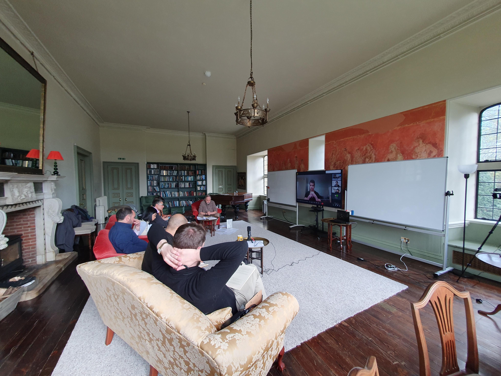
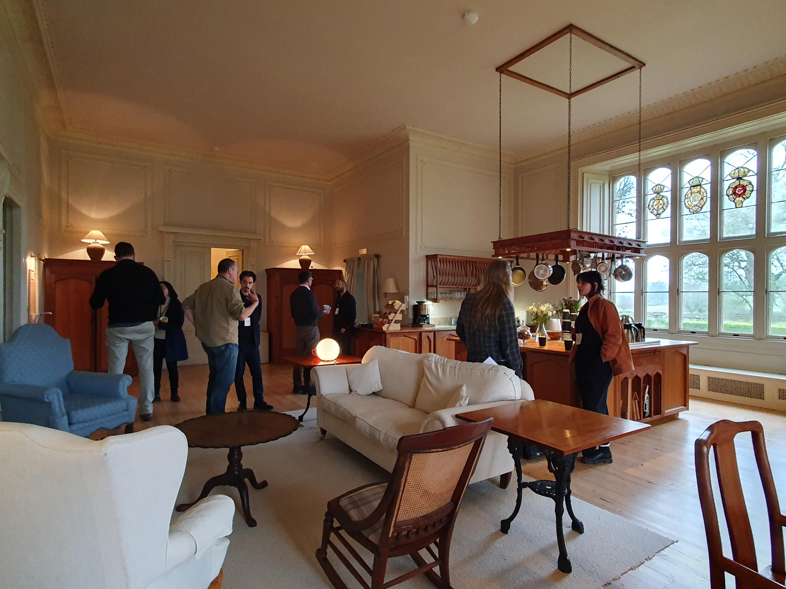

Please [contact us](/contact) if you are interested in (i) funding specific projects, campaigns, or areas of our work, (ii) collaborating with the Odyssean Institute through joint grant applications, or (iii) supporting us by volunteering your time.

