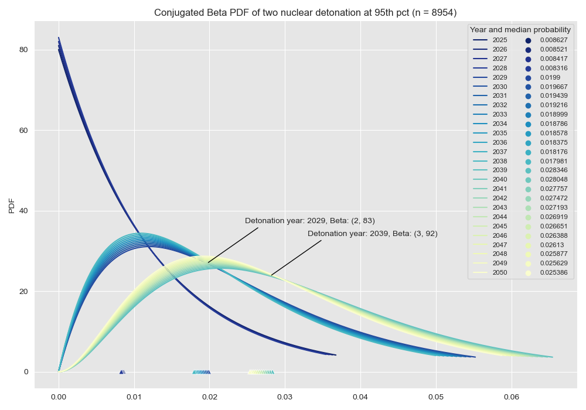

## Resilient Supply Chains

With a rise in global tensions among nuclear-armed nations and recent multilateral withdrawals from arms countrol treaties, coupled with increased deployment of AI in Autonomous Weapon Systems, work on preventative and recovery measures in an event of a large nuclear war have once again become a global priority. A nuclear winter resulting from a large-scale nuclear war poses an existential threat to global civilisation. The climatic effects, including a drop in temperatures and the potential stripping of the ozone layer, would devastate agriculture and food production worldwide in the Northern Latitudes. Key trading chokepoints and infrastructure would likely be targeted even in a limited exchange among major powers. This would severely disrupt global trade and supply chains for food, essential medicine, and more crucially fossil fuel and fossil fuel based fertilisers, resulting in widespread famine and potentially billions of deaths (Xia et al., 2022, Alexander et al., 2022).

However, the precise mechanisms and vulnerabilities in post-nuclear trade and supply chains are poorly understood. Most existing research assumes either complete cessation of trade or full trade conditions, which are both unrealistic. In reality, there would likely be an initial shock to trade networks, followed by partial resumption over time as infrastructures are repaired and peace talks resume. The trajectory of this trade disruption, food price, and recovery will be critical in determining the extent of the nuclear winter famine and loss of lives.

Key infrastructure bottlenecks and chokepoints would be especially vulnerable to disruption, including:

-   Maritime chokepoints like the Turkish Straits, Suez Canal, Strait of Hormuz, Panama Canal, and Strait of Malacca which are vital conduits for food and fuel shipments.

-   Inland waterways such as the Rhine River and Danube River that are critical for European grain distribution.

-   Major port facilities that could face heavy damage from proximity to nuclear explosions, hampering food import and export capacities.

-   Canal networks and locks that enable inland food transport.

-   Shipping routes for fertiliser from major producing regions like the Black Sea.

-   Damaged transport infrastructure obstructing abilities of aid groups to deliver food relief.

There is a lack of sophisticated modelling of the complex dynamics of trade network disruption and recovery following an Abrupt Sunlight Reduction Scenario caused by a nuclear winter. Current models fail to capture the nuanced interplay between biophysical crop loss, economic incentives, logistics infrastructure damage, and trade policies. More complex models are needed to identify vulnerabilities and interventions in post-catastrophe trade and supply chains.

Key Knowledge Gaps:

-   Resilience foods and comparative advantages: Where can key resilience foods (e.g. seaweed, fish) be produced after a nuclear winter? Which nations will have a comparative advantage?

-   Infrastructure bottlenecks: How will damage to roads, ports, and distribution networks constrain post-catastrophe trade flows and more importantly commodity prices? Which chokepoints and links are most fragile?

-   Economic policies: How will countries set trade policies (protectionism, hoarding, export bans) and how will these affect supply and prices for food and fuel?

-   Timing of trade disruption and recovery: What is the trajectory of trade network impairment and restoration over time? How quickly can trade partially resume?

-   Humanitarian assistance: What special challenges arise for aid agencies to deliver food given damaged infrastructure? How can aid best respond?

Significant efforts are needed to narrow these knowledge gaps. Careful investigation into post-catastrophe trade disruption can inform preparedness and policies to mitigate nuclear winter risks. Even incremental improvements to trade network resilience could potentially save millions of lives by avoiding the worst famines. Food price stability is critical to maintaining social order and preventing further cascading conflict. Better modelling can identify the most effective interventions to bolster food system resilience.
